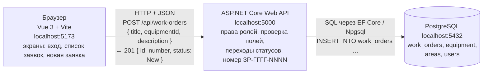

# Архитектура. «ТОиР-Цех»

Курс: Б1.В.ДЭ.01.02.02 · КГЭУ · семестр 1 · 2026/2027  
Студент: Гаранин Антон · Группа: ТРИС-1-23 · ЛР2

Связанные документы: [модель данных](data-model.md) · [API](api-contract.md) · [матрица](requirements-matrix.md)

---

## 1. Схема из трёх узлов



Тот же рисунок текстом:

```text
 Vue 3 + Vite               ASP.NET Core Web API          PostgreSQL
 localhost:5173  ─────────► localhost:5000  ────────────► localhost:5432
 (экраны)        HTTP+JSON  (правила, права)  SQL (EF Core) (хранит строки)

 POST /api/work-orders                       INSERT INTO work_orders
 { "title": "Не включается шпиндель",          (title, equipment_id, description,
   "equipmentId": 3,                            status='New', number='ЗР-2026-0017', …)
   "description": "…ошибка E-12…" }
 ◄── 201 Created { "id": 17, "number": "ЗР-2026-0017", "status": "New" }
```

> архитектура web-ИС семестра

Это и есть архитектура web-ИС семестра: три узла, две связи, один источник правды о заявках на ремонт — база PostgreSQL за сервером ASP.NET Core. Стрелки только «клиент → сервер» и «сервер → база»; прямой стрелки «браузер → PostgreSQL» нет.

## 2. Кто за что отвечает

| Узел | Порт | Что делает | Чего не делает |
|------|------|------------|----------------|
| Vue 3 + Vite (клиент, с ЛР3) | `5173` | рисует три экрана, отправляет HTTP-запросы, показывает ошибки у полей и сообщения `403`/`409` | не хранит «правду», не решает права окончательно (скрытая кнопка — удобство, не защита) |
| ASP.NET Core Web API | `5000` | проверяет вход и роль, валидирует поля, присваивает `id`/`number`/`status`, разрешает или запрещает переходы статуса, ходит в БД | не рисует HTML-экраны |
| PostgreSQL | `5432` | хранит заявки, оборудование, участки и пользователей; держит PK, FK, UNIQUE, CHECK | не принимает подключения из браузера |

## 3. Пример запроса целиком (критерий 1)

| Часть | Значение |
|-------|----------|
| Метод | `POST` |
| Путь | `http://localhost:5000/api/work-orders` |
| Тело | `{ "title": "Не включается шпиндель", "equipmentId": 3, "description": "После смены инструмента шпиндель не стартует, ошибка E-12" }` |
| Код ответа | `201 Created`, в теле `id: 17`, `number: "ЗР-2026-0017"`, `status: "New"` |

Сервер в этом запросе: проверяет, что пользователь — мастер или механик; что `title` 5–80 символов, `equipmentId` существует, `description` 10–500 символов; ставит `status = New`, автора из токена, `assigneeUserId = NULL`, генерирует `number`; делает `INSERT` и возвращает `201`.

## 4. Почему браузер не ходит в PostgreSQL напрямую

1. **Права.** Правила «слесарь меняет только свою заявку» и «назначает только механик» проверяет сервер. Если браузер пишет в БД сам, любой пользователь обойдёт кнопки и выполнит `UPDATE` чужой заявки (ФТ-8, ФТ-9, НФТ-2).
2. **Секреты.** Для подключения к БД нужны логин и пароль PostgreSQL. В браузере их увидит любой через инструменты разработчика. Строка подключения живёт только на сервере, не в репозитории (НФТ-5).
3. **Единые правила.** Проверка полей, допустимые переходы статуса и генерация номера `ЗР-ГГГГ-NNNN` написаны в одном месте. Все клиенты (мастер на одном ПК, механик на другом) получают одинаковый результат.
4. **Один источник правды.** Мастер, механик, слесарь и начальник цеха видят одну и ту же заявку, потому что она лежит в одной базе за одним сервером, а не в памяти каждого браузера.

## 5. Воспроизводимый запуск (план к ЛР с кодом)

Для этой схемы «воспроизводимый запуск» значит: сосед клонирует репозиторий и по README поднимает все три узла на своих портах, не спрашивая автора.

1. PostgreSQL — контейнер `postgres:16` на `5432` (строка подключения — через переменные окружения / `.env`, в Git только `.env.example`).
2. ASP.NET Core — `dotnet run` → `http://localhost:5000`, миграции и начальные данные (участки, оборудование, учётные записи ролей) применяются автоматически.
3. Vue — `npm install && npm run dev` → `http://localhost:5173`, адрес API берётся из настройки `VITE_API_URL=http://localhost:5000`.

Папок `frontend` и `backend` в репозитории пока нет: код начинается со следующих работ.
