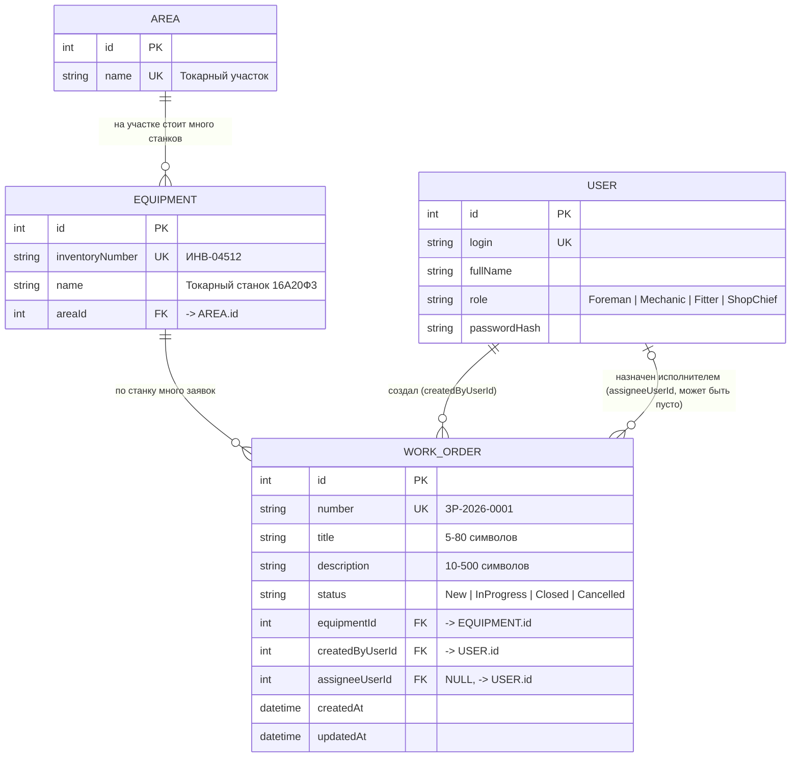
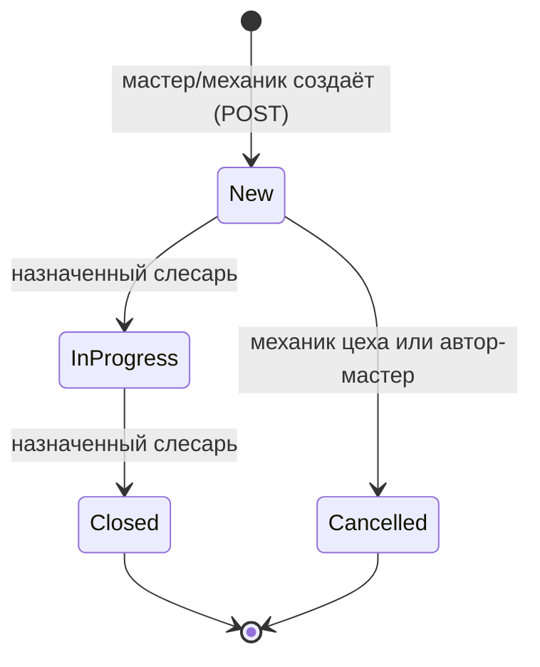

# Модель данных. «ТОиР-Цех»

Курс: Б1.В.ДЭ.01.02.02 · КГЭУ · семестр 1 · 2026/2027  
Студент: Гаранин Антон · Группа: ТРИС-1-23 · ЛР2

Связанные документы: [требования ЛР1](lab-01-requirements.md) · [архитектура](architecture.md) · [API](api-contract.md) · [матрица](requirements-matrix.md)

---

## 1. Словарь проекта

Эти имена используются во всех документах, а дальше — в Vue, C# и SQL. Не меняются в течение семестра.

| Термин курса | Термин моей темы | Сущность / класс | Таблица PostgreSQL | Путь API |
|--------------|------------------|------------------|--------------------|----------|
| Ticket | заявка на ремонт / ТО | `WorkOrder` | `work_orders` | `/api/work-orders` |
| Site | единица оборудования | `Equipment` | `equipment` | `/api/equipment` |
| `siteId` | ссылка на станок | `equipmentId` | `equipment_id` | — |
| — | производственный участок (справочник для оборудования) | `Area` | `areas` | — |
| User | пользователь (мастер, механик, слесарь, начальник цеха) | `User` | `users` | `/api/users` |
| диспетчер | мастер участка | роль `Foreman` | — | — |
| — | механик цеха (назначает) | роль `Mechanic` | — | — |
| инженер | слесарь-ремонтник | роль `Fitter` | — | — |
| руководитель | начальник цеха | роль `ShopChief` | — | — |

В JSON — `camelCase` (`equipmentId`), в PostgreSQL — `snake_case` (`equipment_id`). Это одно и то же поле; отображение делает EF Core.

## 2. Сущности и поля

### 2.1. `WorkOrder` — заявка на ремонт / ТО (главный объект)

| Поле | Тип | Ключ | Обяз. | Кто заполняет | Смысл |
|------|-----|------|-------|---------------|-------|
| `id` | integer, автоинкремент | **PK** | да | сервер | машинный ключ, идёт в адрес `/api/work-orders/17` |
| `number` | varchar(16), уникальный | UNIQUE | да | сервер | человеческий номер `ЗР-2026-0001` |
| `title` | varchar(80) | | да | клиент | краткая суть неисправности, 5–80 символов |
| `description` | varchar(500) | | да | клиент | симптомы и обстоятельства, 10–500 символов |
| `status` | varchar(16) | | да | сервер | `New`, `InProgress`, `Closed`, `Cancelled`; при создании `New` |
| `equipmentId` | integer | **FK → Equipment.id** | да | клиент | какой станок неисправен |
| `createdByUserId` | integer | **FK → User.id** | да | сервер (из токена) | автор — мастер или механик |
| `assigneeUserId` | integer, NULL | **FK → User.id** | нет | сервер по `PATCH …/assignee` | слесарь-ремонтник; у новой заявки пусто |
| `createdAt` | timestamptz | | да | сервер | когда создана |
| `updatedAt` | timestamptz | | да | сервер | последнее изменение назначения или статуса |

Клиент при создании присылает **только** `title`, `equipmentId`, `description`. Поля `id`, `number`, `status`, `createdByUserId`, `assigneeUserId`, даты ставит сервер.

### 2.2. `Equipment` — оборудование (справочник)

| Поле | Тип | Ключ | Обяз. | Смысл |
|------|-----|------|-------|-------|
| `id` | integer, автоинкремент | **PK** | да | машинный ключ |
| `inventoryNumber` | varchar(20), уникальный | UNIQUE | да | инвентарный номер, напр. `ИНВ-04512` |
| `name` | varchar(100) | | да | наименование: «Токарный станок с ЧПУ 16А20Ф3» |
| `areaId` | integer | **FK → Area.id** | да | на каком участке стоит |

### 2.3. `Area` — производственный участок (справочник для оборудования)

| Поле | Тип | Ключ | Обяз. | Смысл |
|------|-----|------|-------|-------|
| `id` | integer, автоинкремент | **PK** | да | машинный ключ |
| `name` | varchar(60), уникальный | UNIQUE | да | «Токарный участок», «Фрезерный участок», «Сборочный участок» |

Участок вынесен в отдельную таблицу, чтобы его название не повторялось в каждой строке оборудования (см. проверку 3НФ). Через API участок отдаётся только внутри ответа оборудования, отдельного экрана нет.

### 2.4. `User` — пользователь

| Поле | Тип | Ключ | Обяз. | Смысл |
|------|-----|------|-------|-------|
| `id` | integer, автоинкремент | **PK** | да | машинный ключ (не фамилия) |
| `login` | varchar(40), уникальный | UNIQUE | да | логин для входа |
| `fullName` | varchar(100) | | да | ФИО для шапки и списка: «Петров С. И.» |
| `role` | varchar(16) | | да | код роли: `Foreman`, `Mechanic`, `Fitter`, `ShopChief` |
| `passwordHash` | varchar(200) | | да | только хеш пароля (НФТ-5); в API не отдаётся |

Роль — фиксированный код (как статус), а не справочник с названием: подпись «Мастер участка» живёт в интерфейсе.

## 3. ER-диаграмма

Диаграмма в формате Mermaid — GitHub рисует её прямо при открытии файла.



Текстовый вариант (на случай, если Mermaid не отрисовался):

```text
┌──────────────┐ 1      N ┌────────────────────┐ 1      N ┌──────────────────────────┐
│ Area         │──────────│ Equipment          │──────────│ WorkOrder                │
│ PK id        │          │ PK id              │          │ PK id                    │
│ name         │          │ inventoryNumber    │          │ number  (ЗР-2026-0001)   │
└──────────────┘          │ name               │          │ title                    │
                          │ FK areaId          │          │ description              │
                          └────────────────────┘          │ status                   │
                                                          │ FK equipmentId           │
┌──────────────┐ 1 ───────────── создал ────────────── N  │ FK createdByUserId       │
│ User         │                                          │ FK assigneeUserId (NULL) │
│ PK id        │ 0..1 ──── назначен исполнителем ───── N  │ createdAt, updatedAt     │
│ login        │                                          └──────────────────────────┘
│ fullName     │
│ role         │
│ passwordHash │
└──────────────┘
```

### Связи словами

- Один участок — много единиц оборудования; каждая единица стоит ровно на одном участке.
- Одна единица оборудования — много заявок на ремонт (станок ломается не один раз); каждая заявка ровно про один станок.
- Один пользователь (мастер или механик) создаёт много заявок; у каждой заявки ровно один автор.
- Один пользователь (слесарь-ремонтник) может быть назначен на много заявок; у заявки **ноль или один** исполнитель.
- У новой заявки исполнителя нет: `assigneeUserId = NULL` до действия «Назначить» механиком цеха.

## 4. Проверка третьей нормальной формы (3НФ)

Наименование станка, его инвентарный номер и участок хранятся один раз — в строке сущности `Equipment`. Заявка `WorkOrder` содержит только внешний ключ `equipmentId`. Если станок переименуют или перенесут на другой участок, меняется одна строка в `equipment`, а во всех заявках по этому станку текст не дублируется и не устаревает. То же для участка: название «Токарный участок» лежит один раз в `Area`, оборудование ссылается на него через `areaId`. ФИО автора и исполнителя хранятся один раз в `User`; в заявке — только `createdByUserId` и `assigneeUserId`.

Проверка по шагам:

- **1НФ:** каждое поле атомарно (один статус, один станок, один исполнитель), повторяющихся групп нет.
- **2НФ:** во всех таблицах ключ простой (`id`), частичных зависимостей быть не может.
- **3НФ:** неключевые поля зависят только от `id` своей таблицы. В `work_orders` нет `equipmentName`, `areaName`, `assigneeName` — они зависят от других ключей и вынесены в справочники.

Поля `equipment.name` и `assignee.fullName` появляются в **ответе API** (сервер делает JOIN для удобства списка), но в таблице заявок они не хранятся.

## 5. `id` и `number` — разные поля

| | `id` | `number` |
|-|------|----------|
| Для кого | для программ: адрес API, внешние ключи | для людей: говорят по телефону, пишут в журнал |
| Пример | `17` | `ЗР-2026-0017` |
| Кто ставит | PostgreSQL (автоинкремент) | сервер ASP.NET Core по шаблону `ЗР-ГГГГ-NNNN` |
| Меняется | никогда | никогда |
| Ограничение | PRIMARY KEY | UNIQUE |

## 6. Статусы и переходы

В JSON и в БД только четыре кода. Подписи на экране — свои.

| Код | На экране |
|-----|-----------|
| `New` | Новая |
| `InProgress` | В ремонте |
| `Closed` | Выполнена |
| `Cancelled` | Отменена |



| Переход | Кто имеет право | Условие |
|---------|-----------------|---------|
| `New` → `InProgress` | слесарь-ремонтник | `assigneeUserId` = текущий пользователь |
| `InProgress` → `Closed` | слесарь-ремонтник | `assigneeUserId` = текущий пользователь |
| `New` → `Cancelled` | механик цеха; мастер участка | мастер — только если `createdByUserId` = он сам |
| любой другой (`New` → `Closed`, из `Closed`/`Cancelled`) | никто | сервер отвечает `409` |

Назначение исполнителя статус **не меняет**: после `PATCH …/assignee` заявка остаётся `New`. Удаления строк нет: отмена — это статус `Cancelled`.

## 7. Ограничения в БД (для ЛР с кодом)

- `work_orders.status` — `CHECK (status IN ('New','InProgress','Closed','Cancelled'))`.
- `users.role` — `CHECK (role IN ('Foreman','Mechanic','Fitter','ShopChief'))`.
- `work_orders.number`, `equipment.inventory_number`, `users.login`, `areas.name` — `UNIQUE`.
- `work_orders.equipment_id`, `created_by_user_id` — `NOT NULL`, FK; `assignee_user_id` — NULL, FK.
- `ON DELETE RESTRICT` на всех FK: оборудование с заявками удалить нельзя (и удаления через API нет).
