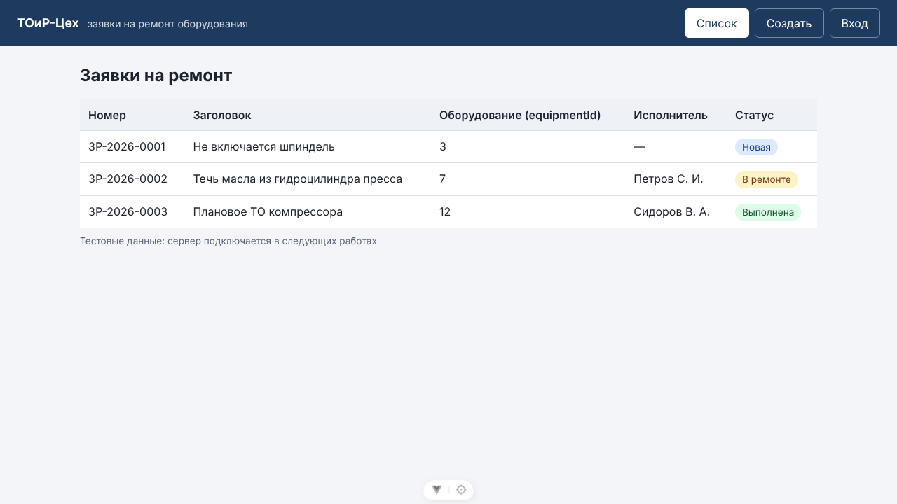
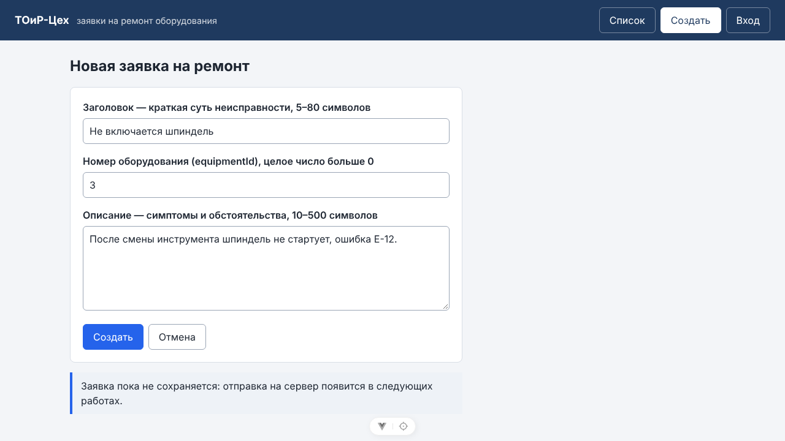
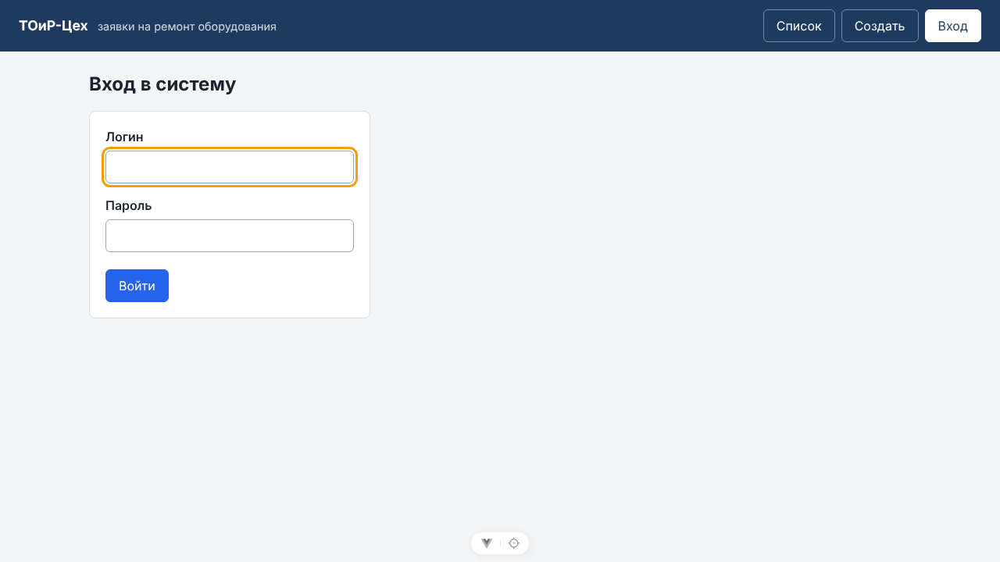

# Отчёт по лабораторной работе № 3

| Поле | Значение |
|------|----------|
| Дисциплина | Б1.В.ДЭ.01.02.02 · РИС и Web |
| Студент | Гаранин Антон |
| Группа | ТРИС-1-23 |
| Дата | 23.10.2026 |
| № ЛР | 3 |
| Тема работы | Vue 3: каркас и три экрана |
| Тема проекта | «ТОиР-Цех» — веб-платформа управления техническим обслуживанием оборудования |

---

## 1. Цель

В том же репозитории поднять клиент Vue 3 на JavaScript в папке `/frontend` так, чтобы сосед по README командой `npm run dev` открыл на `http://localhost:5173` три экрана — список заявок на ремонт, создание заявки и вход — с именами полей из контракта API ЛР2.

## 2. Что сделали

1. Создали каркас командой `npm create vue@latest` в `/frontend`: Vue 3 + Vite, JavaScript, без TypeScript, JSX, Pinia, тестов; ESLint оставлен.
2. В `frontend/vite.config.js` явно закрепили порт `5173` — как на схеме ЛР2.
3. В `frontend/src/App.vue` сделали три экрана, которые переключаются кнопками «Список», «Создать», «Вход» в шапке через `ref('list')` и `v-if` / `v-else-if` / `v-else`. Одновременно показан один `<main>`.
4. **Список** — `<table>` с колонками номер, заголовок, `equipmentId`, исполнитель, статус. Три тестовые заявки (`New`, `InProgress`, `Closed`) выводятся через `v-for` с `:key="item.id"`, текст — через `{{ }}`, без `v-html`. На экране статус подписан по-русски («Новая», «В ремонте», «Выполнена»), в данных — код из API.
5. **Создание** — `<form @submit.prevent>` с тремя полями `title`, `equipmentId` (`type="number"`), `description`; у каждого `<label for>` с подсказкой длины. Фокус ставится на заголовок.
6. **Вход** — `<form>` с полями `login` и `password` (`type="password"`), подписями и кнопкой «Войти». Настоящей проверки пока нет.
7. Общие стили — `frontend/src/assets/main.css`; стили экранов — в `<style scoped>`. `index.html`: `lang="ru"`, заголовок «ТОиР-Цех».
8. В корневой `README.md` добавлены команды запуска клиента; `frontend/README.md` описывает файлы клиента.
9. `node_modules`, `dist`, `.eslintcache` игнорируются Git (`.gitignore` корня и `frontend/.gitignore`).

Связь с ЛР1: **критерий 1 ЛР1** («Создать объект») закрывают поля формы `title`, `equipmentId`, `description` — это тело `POST /api/work-orders` из `docs/api-contract.md`.

## 3. Доказательство успеха

| Что проверяли | Как | Результат |
|---------------|-----|-----------|
| Запуск | `cd frontend && npm install && npm run dev` | Vite пишет `Local: http://localhost:5173/` |
| Повторный запуск | `Ctrl+C`, снова `npm run dev` | адрес снова открывается, `200` |
| Список | открыть `http://localhost:5173` | три строки из массива через `v-for` |
| Создание | кнопка «Создать» в шапке | форма из трёх полей, курсор в поле «Заголовок» |
| Вход | кнопка «Вход» в шапке | форма логина и пароля, виден только этот экран |
| Сборка и линтер | `npm run build`, `npm run lint` | без ошибок |

Экран списка:



Экран создания заявки (поля заполнены, нажата «Создать»):



Экран входа:



## 4. Доказательство ошибки / отказа

| Что сделали неверно / отказ | Ожидание | Факт |
|-----------------------------|----------|------|
| Нажали «Создать» в форме | страница не перезагружается, данные не теряются | `@submit.prevent`: адрес остался `http://localhost:5173/`, появилась подсказка «Заявка пока не сохраняется…» |
| Открыли `App.vue` двойным щелчком | браузер не понимает `.vue` | белый экран / текст файла — запускать только через `npm run dev` |
| `git check-ignore frontend/node_modules` | папка игнорируется | `frontend/.gitignore:10:node_modules` |

## 5. Чеклист семантики

| № | Проверка | да/нет |
|---|----------|--------|
| 1 | Рабочая область обёрнута в `<main>` | да |
| 2 | Создание и вход используют `<form>` | да |
| 3 | У каждого поля есть связанный `<label for>` | да |
| 4 | Список — `<table>` с `<thead>`, `<th scope="col">`, `<caption>` | да |
| 5 | Первое поле создания получает фокус | да (`autofocus` + директива `v-focus` при переключении экрана) |
| 6 | У `v-for` есть `:key="item.id"` | да |
| 7 | Стили читаемы, в `scoped`, подписи не скрыты | да |

## 6. Что осталось на следующую работу

1. ЛР4: подключить vue-router — адреса `/`, `/work-orders/new`, `/login` вместо `v-if`.
2. Вынести экраны из `App.vue` в отдельные компоненты страниц.
3. ЛР5: проверка полей формы (5–80, `equipmentId` > 0, 10–500) с сообщениями у полей.
4. Заменить числовое поле `equipmentId` выпадающим списком из `GET /api/equipment`, когда появится сервер.

## 7. Запуск

```bash
node -v        # LTS 22.18+ или 24
cd frontend
npm install
npm run dev    # http://localhost:5173
```

---

Подпись студента: __________ дата: __________
