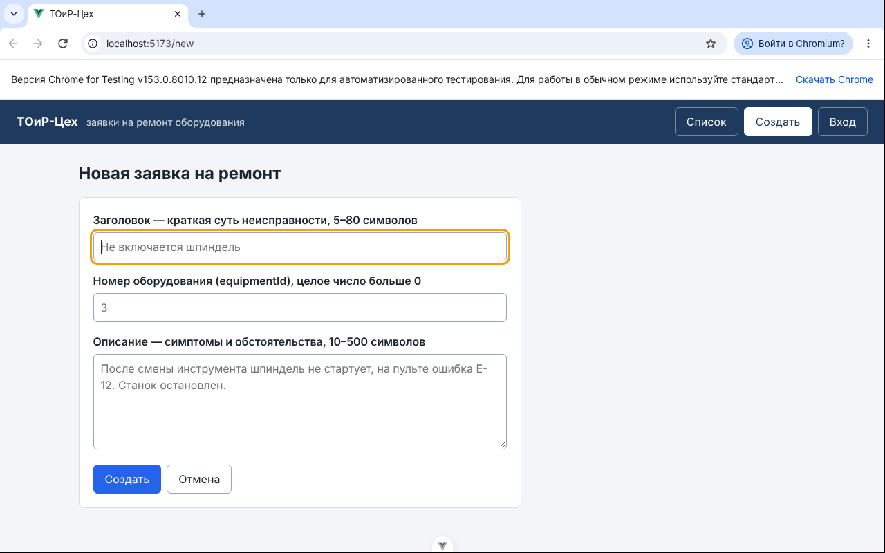
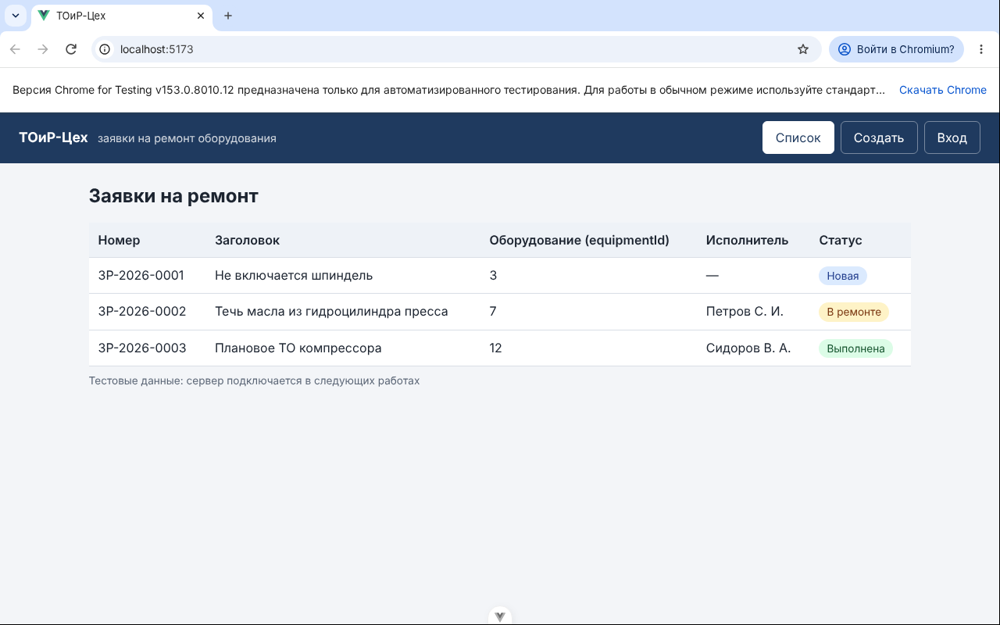
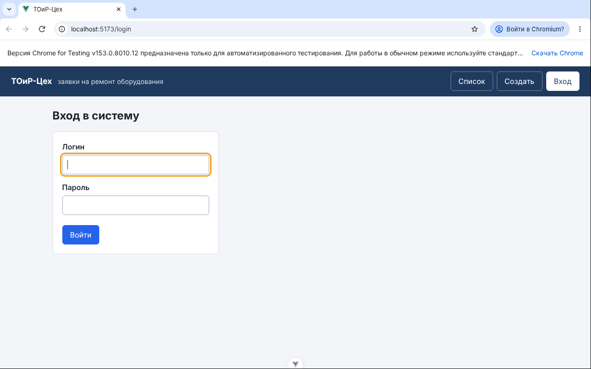

# Отчёт по лабораторной работе № 4

| Поле | Значение |
|------|----------|
| Дисциплина | Б1.В.ДЭ.01.02.02 · РИС и Web |
| Студент | Гаранин Антон |
| Группа | ТРИС-1-23 |
| Дата | 23.10.2026 |
| № ЛР | 4 |
| Тема работы | Vue 3: компоненты и маршруты |
| Тема проекта | «ТОиР-Цех» — веб-платформа управления техническим обслуживанием оборудования |

---

## 1. Цель

Разрезать каркас ЛР3 на компоненты и страницы и подключить `vue-router`. Шапка остаётся на месте, адреса `/`, `/new`, `/login` открываются ручным вводом, таблица получает данные через props, массив заявок лежит в одном модуле `workOrdersStore.js`.

## 2. Что сделали

1. Установили `vue-router` (`npm install vue-router`): он записан в `frontend/package.json` и `package-lock.json`. Pinia не ставили.
2. `src/router.js` — три маршрута через `createRouter` и `createWebHistory`: `/` → `WorkOrderList`, `/new` → `WorkOrderNew`, `/login` → `LoginPage`. В `src/main.js` вызывается `app.use(router)` до `mount`.
3. `src/App.vue` содержит только каркас: `<AppHeader />` и под ним `<router-view />`. Кнопки и `v-if` из ЛР3 удалены.
4. `src/components/AppHeader.vue` — название и меню из трёх `router-link`. Ссылка текущего адреса выделяется по `aria-current="page"`, который ставит сам роутер.
5. `src/components/WorkOrderTable.vue` объявляет обязательный prop `items` (`type: Array, required: true`) и рисует строки через `v-for` с `:key="item.id"`. Своего массива и копии `ref([...props.items])` в таблице нет.
6. `src/workOrdersStore.js` — единственный общий массив `workOrders` (`ref`) с тремя тестовыми заявками.
7. Страницы в `src/pages/`: `WorkOrderList.vue` берёт `workOrders` из store и передаёт в `<WorkOrderTable :items="workOrders" />`; `WorkOrderNew.vue` — форма из ЛР3 (`title`, `equipmentId`, `description`), кнопка «Отмена» ведёт на `/`; `LoginPage.vue` — форма входа.
8. Общие стили страниц и форм перенесены в `src/assets/main.css`; стили шапки и таблицы — в `<style scoped>` своих компонентов.

Названия адаптированы к теме: `Ticket…` → `WorkOrder…`, `ticketsStore.js` → `workOrdersStore.js`. Страница входа названа `LoginPage.vue`, а не `Login.vue`: правило ESLint `vue/multi-word-component-names` требует имени компонента из двух слов.

**Таблица получает массив через props, источник — `workOrdersStore.js`.**

## 3. Дерево `src/`

```text
frontend/src/
├── main.js                ← app.use(router)
├── App.vue                ← AppHeader + router-view
├── router.js              ← три маршрута
├── workOrdersStore.js     ← единственный общий массив
├── assets/
│   └── main.css
├── components/
│   ├── AppHeader.vue
│   └── WorkOrderTable.vue
└── pages/
    ├── WorkOrderList.vue
    ├── WorkOrderNew.vue
    └── LoginPage.vue
```

## 4. Схема: шапка снаружи, страница внутри

```text
┌──────────────────────────────────────────────────────┐
│  App.vue                                             │
│  ┌────────────────────────────────────────────────┐  │
│  │  AppHeader   router-link:  /   /new   /login   │  │  ← всегда виден
│  └────────────────────────────────────────────────┘  │
│  ┌────────────────────────────────────────────────┐  │
│  │  <router-view />                               │  │
│  │     сейчас один из экранов:                    │  │
│  │     • WorkOrderList   путь /                   │  │
│  │         └─ WorkOrderTable :items="workOrders"  │  │
│  │     • WorkOrderNew    путь /new                │  │
│  │     • LoginPage       путь /login              │  │
│  └────────────────────────────────────────────────┘  │
└──────────────────────────────────────────────────────┘

workOrdersStore.js ──import──► WorkOrderList ──props items──► WorkOrderTable
```

## 5. Доказательство успеха

| Что проверяли | Как | Результат |
|---------------|-----|-----------|
| `/` | ввести `http://localhost:5173/` + Enter, затем F5 | список из трёх заявок, шапка на месте |
| `/new` | ввести `http://localhost:5173/new` + Enter, затем F5 | форма создания, курсор в «Заголовке», не белый экран |
| `/login` | ввести `http://localhost:5173/login` + Enter, затем F5 | форма входа, курсор в «Логине» |
| Меню | клик «Создать» на `/` | адрес меняется на `/new`, шапка остаётся |
| Отмена формы | «Отмена» на `/new` | возврат на `/`, в таблице те же три строки |
| Консоль браузера | все три адреса | ошибок и предупреждений нет |
| Линтер и сборка | `npm run lint`, `npm run build` | без ошибок |

Адрес `/new`, введённый вручную (видна адресная строка):



Адрес `/`:



Адрес `/login`:



## 6. Доказательство ошибки / отказа

| Что сделали неверно / отказ | Ожидание | Факт |
|-----------------------------|----------|------|
| Нажали «Создать» в форме на `/new` | запрос на сервер не уходит, страница не перезагружается | `@submit.prevent`, адрес остаётся `/new`, подсказка «Заявка пока не сохраняется…» |
| F5 на любом адресе | тестовые данные возвращаются к исходным | после F5 модуль `workOrdersStore.js` создаётся заново — это ожидаемо, сервера ещё нет |

## 7. Ответы для защиты

1. **Чем `/new` отличается от `POST /api/work-orders`?** `/new` — маршрут Vue на `localhost:5173`: он только выбирает, какую страницу показать. `POST http://localhost:5000/api/work-orders` — будущий HTTP-запрос к серверу, который создаст запись в PostgreSQL. Маршрут сам ничего не создаёт.
2. **Кто владеет массивом записей?** Модуль `workOrdersStore.js`. Страницы его импортируют; таблица получает массив через props и не хранит своего.
3. **Зачем таблице props?** Чтобы таблица рисовала тот же массив, что видят и меняют другие страницы. Если бы таблица держала свою копию, новая заявка из формы попала бы в другой список и на экране не появилась.
4. **Почему шапка снаружи `router-view`?** Шапка одна и не пропадает при смене адреса. Если положить её в страницу, на других адресах меню исчезнет; если скопировать в три страницы — каждую правку меню придётся делать трижды.

## 8. Что осталось на следующую работу

1. ЛР5: форма на `/new` добавляет заявку в общий массив `workOrders` и возвращает на `/`.
2. Проверка полей (5–80, `equipmentId` > 0, 10–500) с сообщениями у полей.
3. Позже: страница одной заявки `/work-orders/:id` (в ЛР4 необязательна).

## 9. Запуск

```bash
cd frontend
npm install
npm run dev    # http://localhost:5173, затем вручную /new и /login
```

---

Подпись студента: __________ дата: __________
