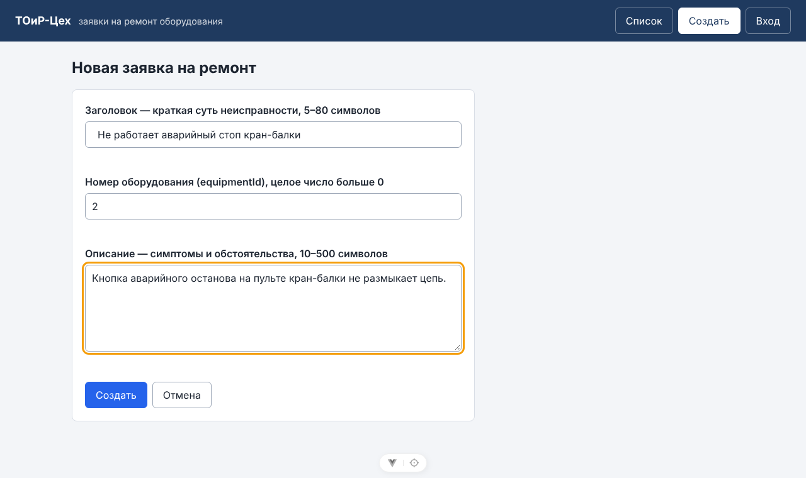
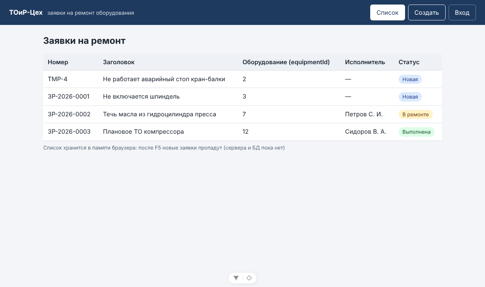
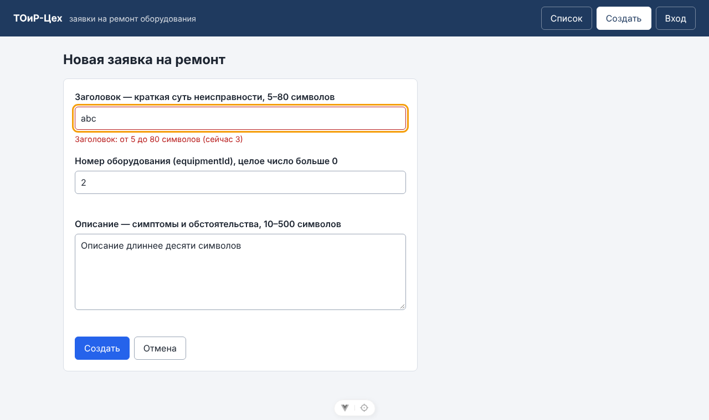
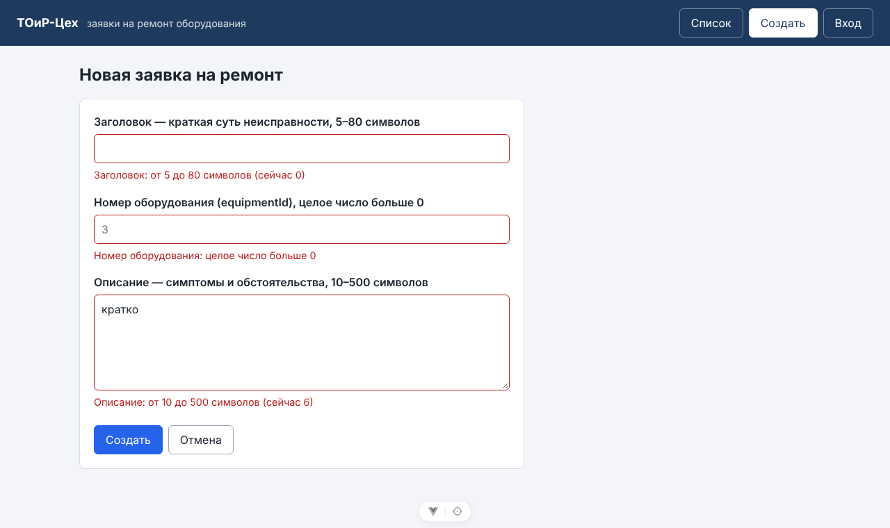
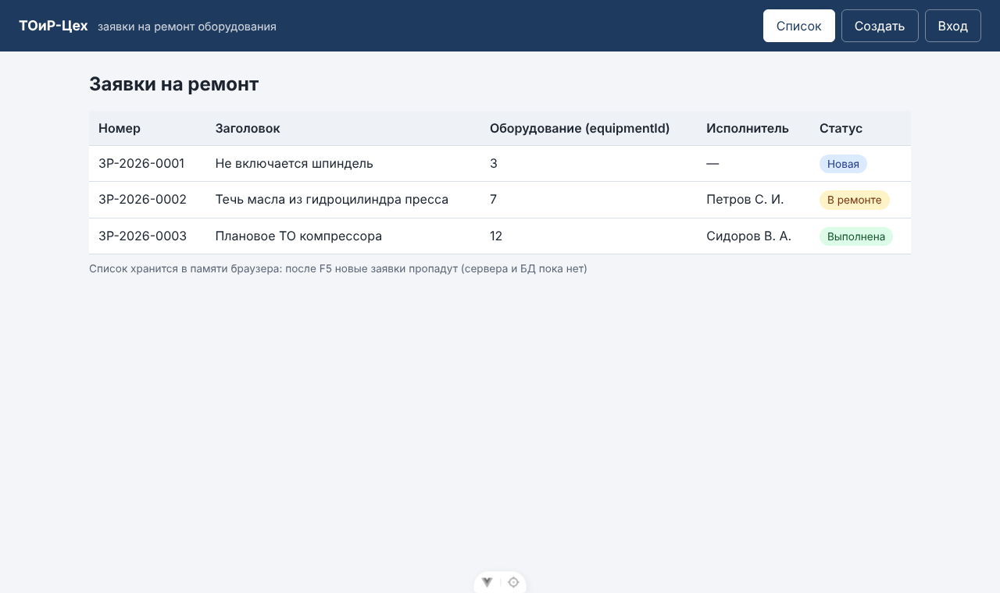

# Отчёт по лабораторной работе № 5

| Поле | Значение |
|------|----------|
| Дисциплина | Б1.В.ДЭ.01.02.02 · РИС и Web |
| Студент | Гаранин Антон |
| Группа | ТРИС-1-23 |
| Дата | 23.10.2026 |
| № ЛР | 5 |
| Тема работы | Vue 3: форма и список в памяти |
| Тема проекта | «ТОиР-Цех» — веб-платформа управления техническим обслуживанием оборудования |

---

## 1. Цель

Связать форму создания заявки на ремонт (`/new`) с общим массивом `workOrders`: корректная отправка добавляет заявку со статусом `New` и возвращает на список `/`; короткий заголовок отклоняется с ошибкой у поля; Enter не перезагружает страницу; после F5 добавленные заявки исчезают, потому что сервера и БД пока нет.

## 2. Что сделали

1. `frontend/src/workOrdersStore.js` — к общему массиву `workOrders` добавлены учебный счётчик `nextId` (начинается с 4, после тестовых записей) и функция `addWorkOrder({ title, equipmentId, description })`. Она сама ставит `id`, `number` вида `TMP-4`, `status: 'New'` и `assignee: null` и кладёт заявку первой в списке (как в UC-1 ЛР1).
2. `frontend/src/workOrderValidation.js` — функция `validateWorkOrder` с правилами ФТ-3 из ЛР1: `title` 5–80 символов после `trim`; `equipmentId` — целое число больше 0; `description` 10–500 символов после `trim`. Возвращает объект ошибок по полям.
3. `frontend/src/pages/WorkOrderNew.vue`:
   - три поля связаны через `v-model` с `form` (`ref`), у `equipmentId` — `v-model.number`;
   - форма отправляется только через `@submit.prevent="onCreate"`;
   - `onCreate` сначала проверяет поля и при ошибке делает `return` до `addWorkOrder`;
   - ошибка выводится под своим полем (`<p class="field-error">`), поле подсвечивается через `aria-invalid`, текст связан с полем через `aria-describedby`;
   - после успеха ошибки очищаются, форма сбрасывается, `router.push('/')`;
   - флаг `submitting` не даёт второму Enter добавить заявку повторно.
4. Подпись под таблицей (`WorkOrderTable.vue`) предупреждает, что список живёт в памяти браузера и сбрасывается после F5.

Второго массива нет: и форма, и список используют один `workOrders` из `workOrdersStore.js`. Новая запись содержит поля `id, number, title, equipmentId, description, status` (+ `assignee: null`).

## 3. Три доказательства

| Проверка | Что делаем | Факт |
|----------|------------|------|
| **Успех** | заголовок «Не работает аварийный стоп кран-балки», `equipmentId = 2`, описание 66 символов → Enter | переход на `/`, первой строкой `TMP-4`, статус «Новая» (`New`), всего 4 строки |
| **Отказ** | заголовок `abc` → Enter | адрес остался `/new`, под полем «Заголовок: от 5 до 80 символов (сейчас 3)», в списке по-прежнему 3 строки |
| **Память** | F5 на `/` после успешного создания | строка `TMP-4` исчезла, снова 3 тестовые заявки. **Ожидаемо: сервера и БД пока нет** — массив живёт в памяти вкладки и при перезагрузке создаётся заново из `workOrdersStore.js` |

### Успех

Форма перед отправкой:



После Enter — список, новая заявка первой со статусом «Новая»:



### Отказ

Заголовок `abc` — строка не добавлена, ошибка под полем:



Заголовок из одного пробела, пустой номер оборудования, описание «кратко» — три ошибки, каждая у своего поля:



### F5

После обновления страницы добавленная `TMP-4` пропала:



## 4. Дополнительные проверки

| Проверка | Как | Результат |
|----------|-----|-----------|
| Enter не перезагружает страницу | перед отправкой записали в `window` метку, нажали Enter в поле с ошибкой | метка сохранилась, адрес не изменился — перезагрузки не было |
| Тип `equipmentId` | ввели `2`, после создания прочитали первую запись из `workOrdersStore.js` | `typeof equipmentId === 'number'`, значение `2` (не строка `"2"`) |
| `trim` заголовка | ввели заголовок с пробелами по краям | в списке сохранён без пробелов |
| Двойной Enter | два Enter подряд в корректной форме | добавлена одна заявка (`TMP-4`), не две |
| Уникальный `id` | создали вторую заявку в той же сессии | номера `TMP-5`, `TMP-4` — не повторяются |
| Очистка формы | вернулись на `/new` после успеха | все поля пустые |
| Консоль браузера | весь сценарий | ошибок и предупреждений нет |
| Линтер и сборка | `npm run lint`, `npm run build` | без ошибок |

Временный вывод `typeof` в интерфейс не добавлялся: тип проверен из консоли браузера через модуль store.

## 5. `script` и `template`

| Задача | В `<script setup>` | В `<template>` |
|--------|--------------------|----------------|
| Объявить форму | `const form = ref(emptyForm())` | — |
| Прочитать поле | `form.value.title.trim()` | `v-model="form.title"` |
| Число из поля | — | `v-model.number="form.equipmentId"` |
| Отправить форму | `function onCreate() { … }` | `<form @submit.prevent="onCreate">` |
| Показать ошибку | `errors.value = validateWorkOrder(form.value)` | `{{ errors.title }}` под полем |
| Добавить в список | `addWorkOrder({ … })` из `workOrdersStore.js` | — |
| Уйти на список | `router.push('/')` | — |

## 6. Ответы для защиты

1. **Зачем `.prevent`?** Обычная HTML-форма по Enter отправляется браузером и перезагружает страницу — Vue-приложение и массив в памяти создаются заново. `.prevent` отменяет это и вызывает нашу функцию `onCreate`.
2. **Почему у `equipmentId` нужен `.number`?** Поле `<input>` всегда отдаёт строку. Без `.number` в заявку попадёт `"2"`, а API ЛР2 и проверка «целое больше 0» ожидают число.
3. **Где хранится массив?** В одном модуле `frontend/src/workOrdersStore.js` (`workOrders`). Форма добавляет через `addWorkOrder`, список передаёт тот же массив в таблицу через props.
4. **Почему F5 очищает новые записи?** Массив живёт в оперативной памяти вкладки. F5 загружает приложение заново, модуль store снова создаётся из тестовых данных. Сохранение появится, когда форма будет отправлять `POST /api/work-orders` на сервер, а сервер писать в PostgreSQL.

## 7. Что осталось на следующую работу

1. ЛР6: форма вызывает API-модуль вместо прямой записи в массив; `id` и `number` (`ЗР-ГГГГ-NNNN`) приходят из ответа.
2. Номер оборудования выбирать из списка (`GET /api/equipment`), а не вводить числом.
3. Те же правила полей повторить на сервере (ЛР8).

## 8. Запуск

```bash
cd frontend
npm install
npm run dev    # http://localhost:5173/new
```

---

Подпись студента: __________ дата: __________
