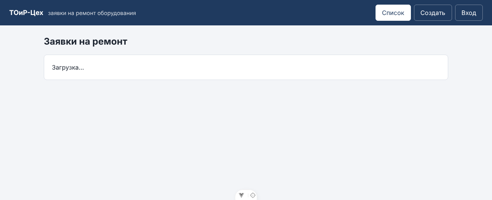
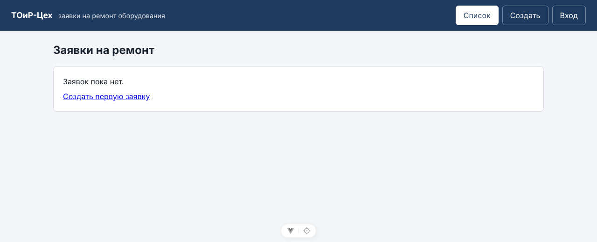
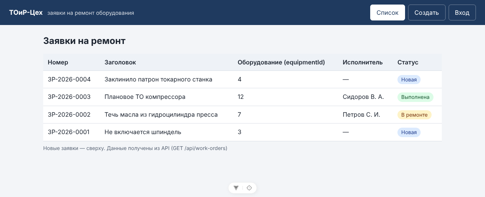
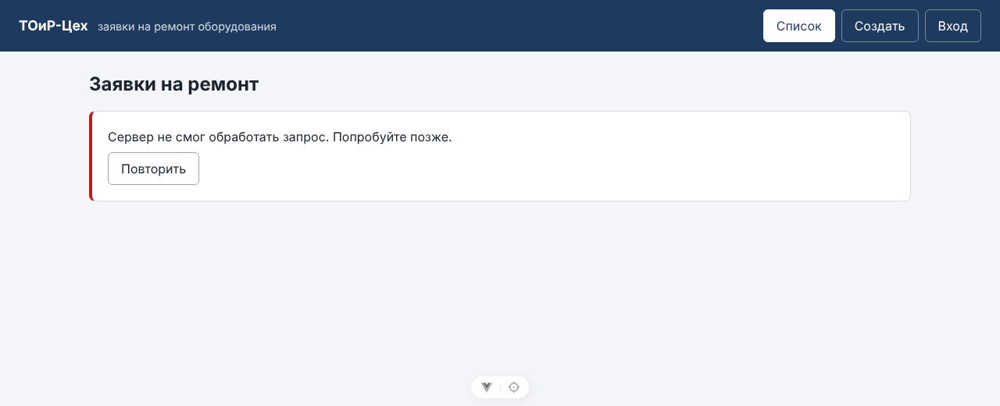
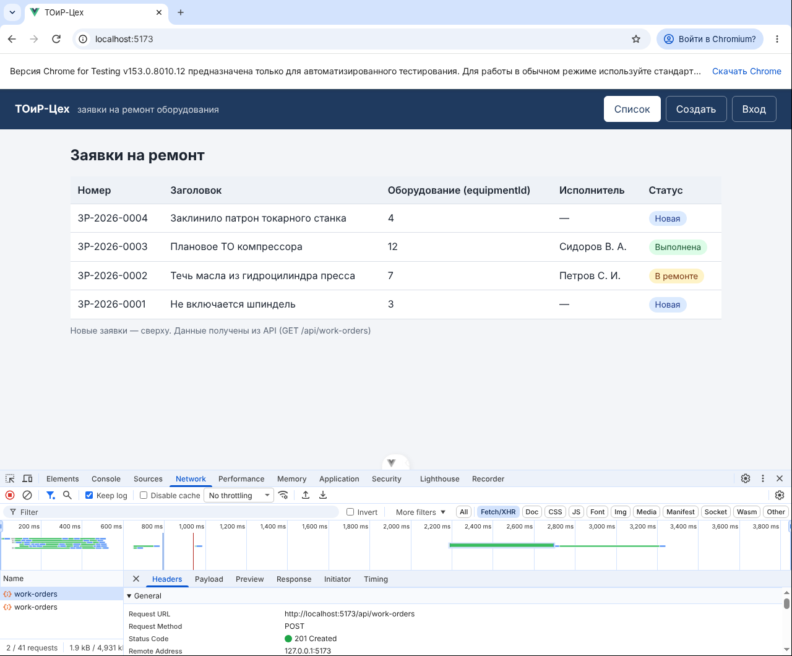
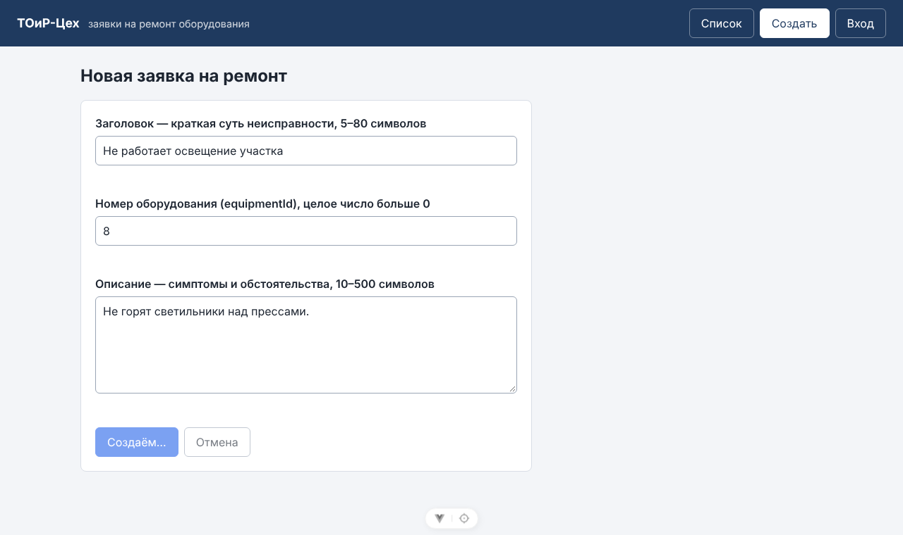
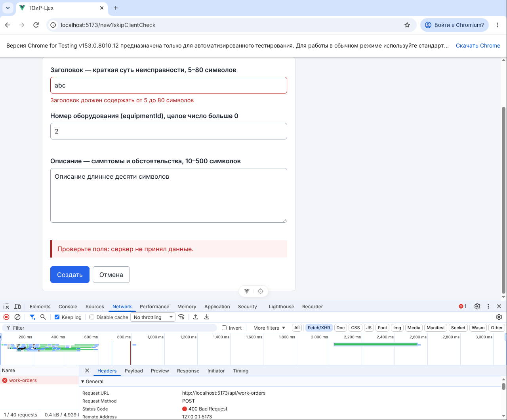
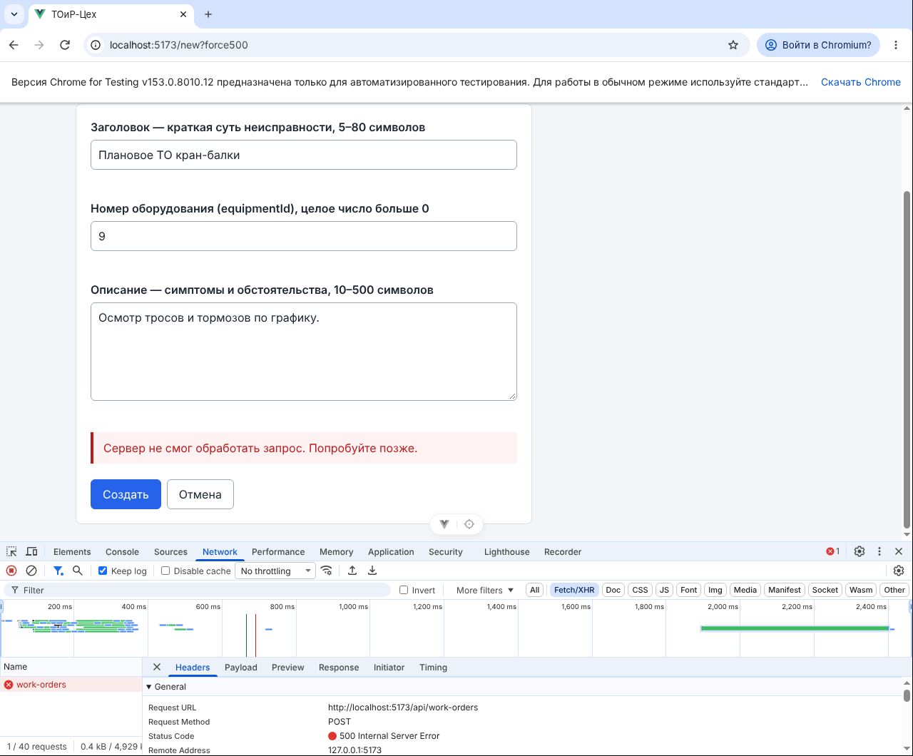
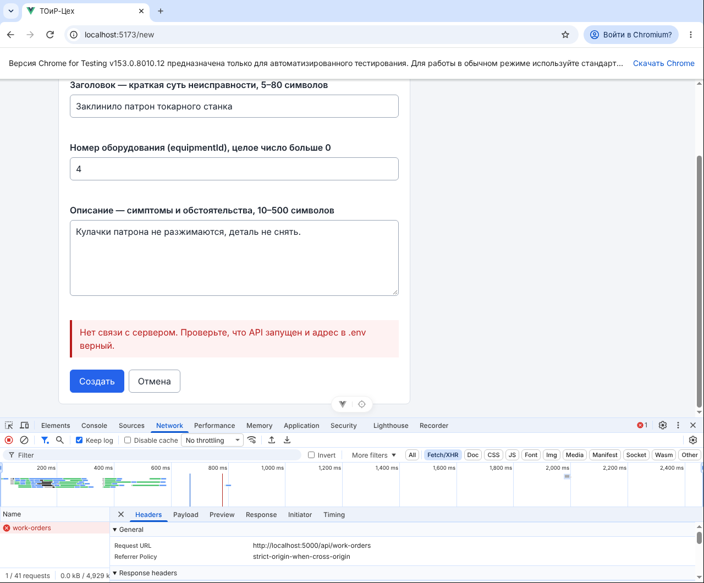

# Отчёт по лабораторной работе № 6

| Поле | Значение |
|------|----------|
| Дисциплина | Б1.В.ДЭ.01.02.02 · РИС и Web |
| Студент | Гаранин Антон |
| Группа | ТРИС-1-23 |
| Дата | 23.10.2026 |
| № ЛР | 6 |
| Тема работы | Vue 3: клиент API и mock |
| Тема проекта | «ТОиР-Цех» — веб-платформа управления техническим обслуживанием оборудования |

---

## 1. Цель

Отделить экраны от способа получения данных. Список заявок на ремонт и форма создания вызывают только функции API-модуля `getWorkOrders()` и `createWorkOrder(body)`. Пока сервера на C# нет, отвечает учебный mock. Список показывает одно из четырёх состояний (загрузка / пусто / данные / ошибка). Форма блокирует кнопку на время POST и различает три отказа: 400, 500 и «нет связи». `id` и `number` новой заявки берутся из ответа, а не придумываются страницей.

## 2. Что сделали

1. **Адрес API.** `frontend/.env.example` (в Git) и локальный `frontend/.env` (не в Git, правило `.env` в корневом `.gitignore`): `VITE_API_BASE_URL=http://localhost:5000`. Адрес читается только в `src/api/workOrders.js` через `import.meta.env.VITE_API_BASE_URL`.
2. **API-модуль `src/api/workOrders.js`:**
   - единственный переключатель `USE_MOCK`;
   - функции `getWorkOrders()` → `GET /api/work-orders` и `createWorkOrder(body)` → `POST /api/work-orders` на встроенном `fetch`, без axios;
   - `!response.ok` превращается в `ApiError` с HTTP-статусом: `validation` для 400, `server` для 5xx, `http` для остальных кодов;
   - если ответа нет вовсе (`catch` вокруг `fetch`), это `ApiError` вида `network`, а не «500»;
   - `errorMessage(error)` даёт человеку текст по виду отказа.
3. **Mock `src/api/mockWorkOrders.js`** — учебный «сервер» по контракту ЛР2:
   - пауза 500 мс;
   - список отдаёт `200`, пустой список — `200` и `[]`;
   - создание: короткий `title`, неверный `equipmentId` или `equipmentId`, которого нет в справочнике (например `999`), дают `400` с ошибками по полям; иначе `201`;
   - в ответе `201` серверные `id`, `number` вида `ЗР-2026-0004` и `status: 'New'`;
   - учебный флаг `force500` даёт `500`.
4. **Как mock подключён.** Mock подключён к dev-серверу Vite плагином `frontend/vite-mock-api.js` на том же пути `/api/work-orders`. Поэтому запросы к mock — настоящие HTTP-запросы с настоящими кодами, они видны в F12 → Network. Это вариант 1 из карточки ЛР6: mock через `fetch` на учебный путь. Страницы `mockWorkOrders.js` не импортируют. В сборку `npm run build` mock не попадает.
5. **Учебные флаги в адресе страницы**, чтобы воспроизводить отказы без правки кода:
   - `/?empty` — пустой список;
   - `?force500` — ответ 500;
   - `/new?skipClientCheck` — отправить поля без проверки в браузере и получить 400 от сервера.
6. **Список `pages/WorkOrderList.vue`.** Одно поле `screen` со значениями `'loading' | 'empty' | 'data' | 'error'`, загрузка в `onMounted`, в шаблоне взаимоисключающие `v-if` / `v-else-if` / `v-else`, на ошибке кнопка «Повторить».
7. **Форма `pages/WorkOrderNew.vue`:**
   - сначала клиентская проверка из ЛР5, затем `await createWorkOrder({ title, equipmentId, description })`;
   - созданная заявка берётся целиком из ответа и кладётся в общий `workOrders`, затем переход на `/`;
   - при 400 ошибки из ответа (`errors.title`, `errors.equipmentId`…) показываются у полей;
   - при любом отказе поля не очищаются;
   - `isSubmitting` и ранний `return`, кнопка `:disabled` с текстом «Создаём…», флаг снимается в `finally`.
8. **`workOrdersStore.js`** — общий массив без тестовых данных и без счётчика `id`: он заполняется ответом API.

## 3. Четыре состояния списка

| Состояние | Как получить | Что видно |
|-----------|--------------|-----------|
| `loading` | открыть `/` — первые 0,5 с | «Загрузка…» |
| `empty` | `/?empty` — ответ `200`, `[]` | «Заявок пока нет» + ссылка «Создать первую заявку» |
| `data` | `/` — ответ `200`, массив не пуст | таблица |
| `error` | `/?force500` — ответ `500` | «Сервер не смог обработать запрос…» + «Повторить» |

Одновременно показано только одно состояние.









## 4. Успешное создание — Network

Заполнили форму («Заклинило патрон токарного станка», `equipmentId = 4`) и нажали «Создать». В Network (фильтр Fetch/XHR): `POST http://localhost:5173/api/work-orders` → **201 Created**, затем `GET` списка. В таблице первая строка — `ЗР-2026-0004`: номер выдал mock-«сервер», страница его не вычисляла.



Во время ожидания ответа кнопка заблокирована и подписана «Создаём…»:



## 5. Чеклист трёх отказов

| Отказ | Как воспроизвести | Что в Network / коде | Текст человеку | Скрин есть |
|-------|-------------------|----------------------|----------------|------------|
| 400 | `/new?skipClientCheck`, заголовок `abc` (или `equipmentId = 999` без флага — такого станка нет в справочнике) | `POST` → **400 Bad Request**, ветка `!response.ok`, `kind: 'validation'` | «Проверьте поля: сервер не принял данные.» + у поля «Заголовок должен содержать от 5 до 80 символов» | да |
| 500 | `/new?force500` (или `/?force500` для списка) | `POST` → **500 Internal Server Error**, ветка `!response.ok`, `kind: 'server'` | «Сервер не смог обработать запрос. Попробуйте позже.» | да |
| Нет связи | `USE_MOCK = false`, API на `:5000` не запущен | `POST http://localhost:5000/api/work-orders` → **(failed) net::ERR_CONNECTION_REFUSED**, ответа нет, срабатывает `catch`, `kind: 'network'` | «Нет связи с сервером. Проверьте, что API запущен и адрес в .env верный.» | да |

Три случая — три разных текста. После каждого отказа кнопка снова активна (`finally`), введённые поля остаются, их можно исправить и отправить снова.

### 400 — поля не прошли проверку на сервере



### 500 — сервер не смог обработать



### Нет связи — ответа нет

Запрос ушёл на порт `5000` из `.env`, сервер там не запущен:



## 6. Дополнительные проверки

| Проверка | Как | Результат |
|----------|-----|-----------|
| Двойной клик по «Создать» | `dblclick` по кнопке | ушёл **один** `POST`, в списке одна новая строка |
| Клиентская проверка осталась | заголовок `abc` без флага | `POST` не отправлен, ошибка у поля из ЛР5 |
| `id` и `number` из ответа | создание → первая строка списка | `ЗР-2026-0004`, а не `TMP-…` |
| Пустой список ≠ загрузка | `/?empty` | после «Загрузка…» — «Заявок пока нет» |
| `DELETE /api/work-orders` | `curl -X DELETE` | `405` — метода нет, как в контракте ЛР2 |
| `.env` не в Git | `git status` | `frontend/.env` не отображается (игнорируется), `frontend/.env.example` — новый файл |
| Линтер и сборка | `npm run lint`, `npm run build` | без ошибок; данные mock в `dist/` не попали |

## 7. Ответы для защиты

1. **Почему `400` не попадает в `catch`?** `fetch` бросает исключение, только если ответа не было. Ответ «400» — это полученный ответ сервера, поэтому `fetch` завершается успешно, а отказ видно по `response.ok === false` и `response.status === 400`.
2. **Чем `500` отличается от отсутствия сети?** При `500` сервер работает и ответил, что не смог обработать запрос: в Network есть статус 500. При «нет связи» ответа нет вовсе: сервер не запущен, неверный адрес или нет сети. В Network статус `(failed)`, в коде срабатывает `catch`. Человеку нужны разные советы: «попробуйте позже» и «проверьте, что сервер запущен».
3. **Откуда берутся `id` и `number`?** Из ответа `POST /api/work-orders`. Их выдаёт сервер: сейчас mock, на ЛР12 — ASP.NET Core с PostgreSQL. Страница кладёт в список созданный объект целиком и ничего не вычисляет, иначе на живом API появились бы два разных номера.
4. **Зачем блокировать кнопку во время POST?** Пока ответ не пришёл, второй клик или Enter отправил бы второй `POST`, и сервер создал бы две одинаковые заявки. `isSubmitting` с ранним `return` и `:disabled` оставляют только один незавершённый запрос. Флаг снимается в `finally`, поэтому после ошибки кнопка снова работает.

**Куда на ЛР12 подставят `http://localhost:5000`:** в `.env` адрес уже есть. В `src/api/workOrders.js` поставить `USE_MOCK = false`, и запросы пойдут на `http://localhost:5000/api/work-orders`. Страницы не меняются.

## 8. Что осталось на следующую работу

1. Сервер ASP.NET Core на порту 5000 с теми же `GET` / `POST /api/work-orders` и теми же правилами 400 (ЛР7–8).
2. Для живого API настроить CORS: клиент на `:5173`, сервер на `:5000`.
3. Номер оборудования выбирать из `GET /api/equipment`.

## 9. Запуск

```bash
cd frontend
copy .env.example .env    # Windows; Linux/macOS: cp .env.example .env
npm install
npm run dev               # http://localhost:5173 — список; /?empty, /?force500, /new?force500, /new?skipClientCheck
```

---

Подпись студента: __________ дата: __________
