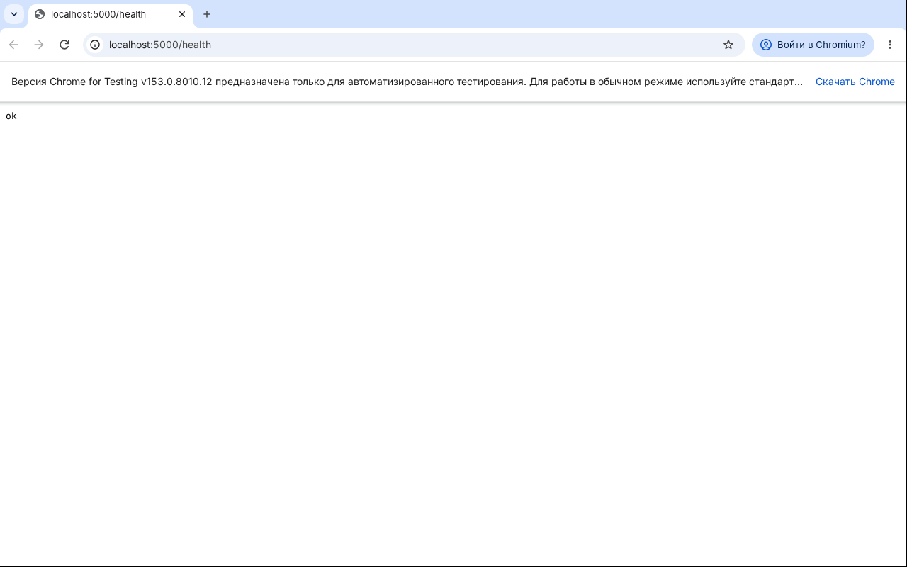
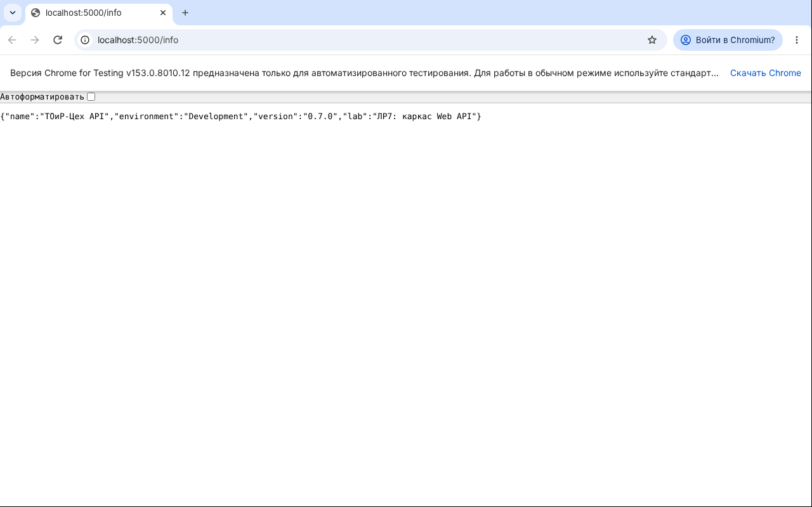

# Отчёт по лабораторной работе № 7

| Поле | Значение |
|------|----------|
| Дисциплина | Б1.В.ДЭ.01.02.02 · РИС и Web |
| Студент | Гаранин Антон |
| Группа | ТРИС-1-23 |
| Дата | 23.10.2026 |
| № ЛР | 7 |
| Тема работы | ASP.NET Core: каркас Web API |
| Тема проекта | «ТОиР-Цех» — веб-платформа управления техническим обслуживанием оборудования |

---

## 1. Цель

Поднять в том же репозитории каркас ASP.NET Core Web API в папке `/backend` на `http://localhost:5000` (как на схеме ЛР2): Swagger в Development, служебные адреса `/health` и `/info`, слои `Controllers` / `Services` / `Models` / `Data` и сервис, зарегистрированный через DI. Сосед запускает сервер по README. Создание заявок в эту работу не входит.

## 2. Что сделали

1. **Проект.** Создан командой `dotnet new webapi -o backend --use-controllers` (.NET SDK 10, `net10.0`). Папка `backend` лежит рядом с `frontend` и `docs`, не внутри них. Пример шаблона `WeatherForecast` удалён.
2. **Порт.** `backend/Properties/launchSettings.json`: профиль `http` с `applicationUrl: http://localhost:5000` и `ASPNETCORE_ENVIRONMENT=Development`. При `dotnet run` терминал пишет `Now listening on: http://localhost:5000`. HTTPS-профиль шаблона и `UseHttpsRedirection` убраны: проверка курса идёт по HTTP 5000.
3. **Swagger.** `backend/Program.cs`:
   - `AddOpenApi()` + `MapOpenApi()` — описание API по адресу `/openapi/v1.json`; это пакет `Microsoft.AspNetCore.OpenApi` из шаблона .NET 10;
   - `UseSwaggerUI(...)` — страница Swagger на `/swagger`, пакет `Swashbuckle.AspNetCore.SwaggerUI` 10.3.1;
   - оба подключены только в Development.
4. **Служебные адреса** (Minimal API):
   - `GET /health` → `200`, текст `ok`;
   - `GET /info` → `200`, JSON с именем приложения, средой, версией и пометкой ЛР7. Имя и версия берутся из `appsettings.json`, секция `App`.
5. **Слои:**
   - `Controllers/WorkOrdersController.cs` — главный ресурс `api/work-orders`, пока один тестовый `GET`, который отдаёт `200` и `[]`;
   - `Services/IWorkOrderService.cs` и `Services/InMemoryWorkOrderService.cs` — интерфейс и заготовка сервиса со списком в памяти;
   - `Models/WorkOrder.cs` — модель заявки с полями из `docs/data-model.md` и коды статусов `New`, `InProgress`, `Closed`, `Cancelled`;
   - `Data/README.md` — назначение папки: контекст EF Core для PostgreSQL в ЛР10. Файл нужен, чтобы пустая папка попала в Git.
6. **DI.** В `Program.cs`: `builder.Services.AddSingleton<IWorkOrderService, InMemoryWorkOrderService>()`. Контроллер получает `IWorkOrderService` через конструктор.
   > Сервис зарегистрирован через DI, чтобы контроллер не создавал реализацию через `new`.

   Singleton выбран, чтобы все запросы видели один и тот же список в памяти.
7. **`backend/backend.http`** — готовые запросы `/health`, `/info`, `/api/work-orders` для VS Code / Rider / Visual Studio.
8. **`.gitignore`:**
   - `**/bin/` и `**/obj/`;
   - `*.pfx` — локальные сертификаты;
   - `*.user`, `.vs/` — пользовательские настройки IDE.

   Правило, которое игнорировало `appsettings.Development.json`, снято: методичка требует этот файл в Git, а секретов в нём нет. Пароли и строку подключения к БД будем хранить в `dotnet user-secrets` или переменных окружения (НФТ-5).
9. **README** — блок запуска backend, адреса API и Swagger, ограничения ЛР7.

## 3. Доказательство успеха

| Что проверяли | Как | Результат |
|---------------|-----|-----------|
| SDK | `dotnet --version` | `10.0.113` |
| Сборка | `dotnet build` | `Build succeeded` |
| Порт и среда | `dotnet run` | `Now listening on: http://localhost:5000`, `Hosting environment: Development` |
| `/health` | браузер / `curl` | `200`, `text/plain`, тело `ok` |
| `/info` | браузер / `curl` | `200`, `{"name":"ТОиР-Цех API","environment":"Development","version":"0.7.0","lab":"ЛР7: каркас Web API"}` |
| Контроллер через DI | `GET /api/work-orders` | `200`, `[]` — список в памяти пуст |
| `/health` не принимает заявку | `POST /health` с `{"title":"abc"}` | `405 Method Not Allowed` |
| Создания ещё нет | `POST /api/work-orders` | `405` — метод появится в ЛР8 |
| Swagger | `http://localhost:5000/swagger` | страница Swagger со списком адресов (проверить и вставить скрин — см. ниже) |

Вывод терминала при запуске:

```text
Using launch settings from backend/Properties/launchSettings.json...
info: Microsoft.Hosting.Lifetime[14]
      Now listening on: http://localhost:5000
info: Microsoft.Hosting.Lifetime[0]
      Application started. Press Ctrl+C to shut down.
info: Microsoft.Hosting.Lifetime[0]
      Hosting environment: Development
```

`GET /health`:



`GET /info`:



**Swagger.** Скрин страницы `http://localhost:5000/swagger` добавить после запуска на своём компьютере: `docs/reports/img/lab-07-swagger.png`. На странице должны быть разделы `WorkOrders` (`GET /api/work-orders`) и «Служебные» (`GET /health`, `GET /info`).

<!--  -->

## 4. Доказательство ошибки / отказа

| Что сделали неверно / отказ | Ожидание | Факт |
|-----------------------------|----------|------|
| Отправили данные заявки на `/health` (`POST /health`, `{"title":"abc"}`) | `/health` их не принимает | `405 Method Not Allowed` |
| Попробовали создать заявку `POST /api/work-orders` | создания ещё нет | `405` — реализация в ЛР8 |
| Перезапустили сервер (`Ctrl+C`, `dotnet run`) | данные в памяти не сохраняются | список снова `[]` (в ЛР7 он и так пуст; заметно станет в ЛР8) |

## 5. Чеклист `/health` ≠ создание заявки

| Утверждение | да/нет |
|-------------|--------|
| `/health` возвращает `200` без тела заявки (`ok`) | да |
| `/health` не принимает `title`, `equipmentId`, `description` (только `GET`, на `POST` — `405`) | да |
| Успешный `/health` не доказывает работу `POST /api/work-orders` | да |
| Создание главного объекта относится к ЛР8 | да |
| README прямо объясняет это различие («`/health` проверяет только живость процесса…», «данные заявок пока в памяти…») | да |
| Swagger и `/health` проверены отдельно (два разных адреса) | да |

## 6. Ответы для защиты

1. **Чем C# отличается от ASP.NET Core?** C# — язык, на котором написаны файлы `.cs`. .NET — платформа, которая их собирает и запускает (`dotnet run`). ASP.NET Core — веб-фреймворк на .NET, который принимает HTTP-запросы, разбирает маршруты и вызывает контроллеры. Можно писать на C# консольную программу без всякого ASP.NET Core.
2. **Зачем DI, если можно написать `new`?** При `new InMemoryWorkOrderService()` контроллер навсегда привязан к хранению в памяти. Через DI контроллер знает только интерфейс `IWorkOrderService`. В ЛР10 в `Program.cs` поменяем одну строку регистрации на реализацию с PostgreSQL, а контроллер не изменится. Ещё DI даёт один общий экземпляр (singleton), поэтому все запросы видят один список.
3. **Что доказывает успешный `/health`?** Только то, что процесс сервера запущен, слушает порт 5000 и конвейер отвечает на запрос. Он не проверяет ни создание заявок, ни проверку полей, ни базу данных.
4. **Почему создание заявки ещё не готово?** В контроллере есть только `GET` списка, а в сервисе — только чтение. `POST /api/work-orders` с правилами полей (5–80, `equipmentId` > 0, 10–500), номером `ЗР-ГГГГ-NNNN` и статусом `New` — задача ЛР8. Сейчас такой запрос получает `405`.

## 7. Что осталось на следующую работу

1. ЛР8: `POST /api/work-orders` в контроллере и сервисе, проверка полей, ответы `201` / `400` по контракту ЛР2.
2. `GET /api/work-orders/{id}` с `404`.
3. Позже: CORS для клиента на `:5173`, переключение Vue с mock на сервер (`USE_MOCK = false`).

## 8. Запуск

```bash
dotnet --version     # .NET SDK 10
cd backend
dotnet restore
dotnet run           # http://localhost:5000, Swagger — http://localhost:5000/swagger
```

---

Подпись студента: __________ дата: __________
