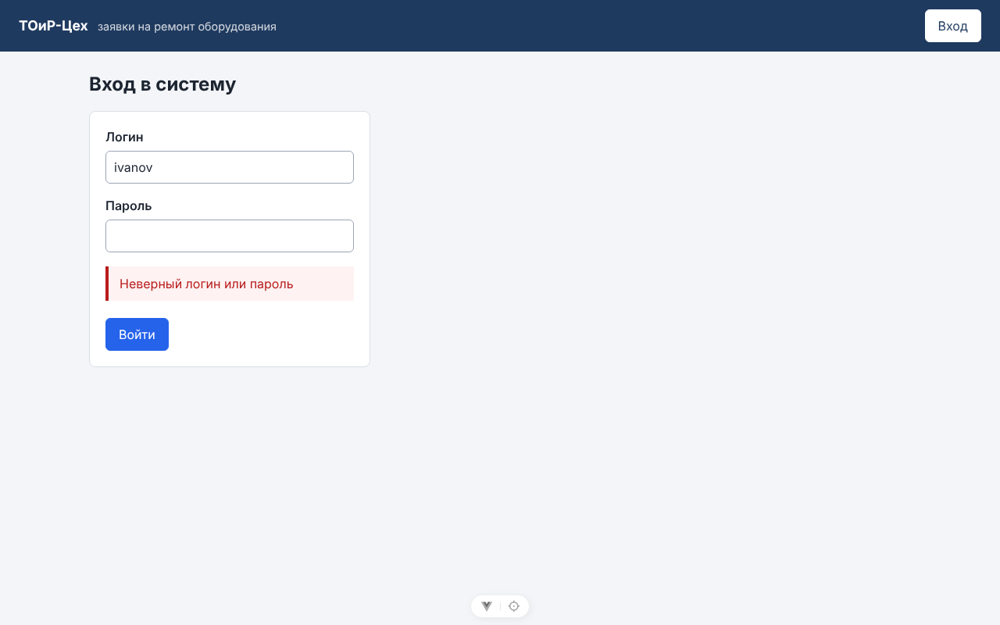
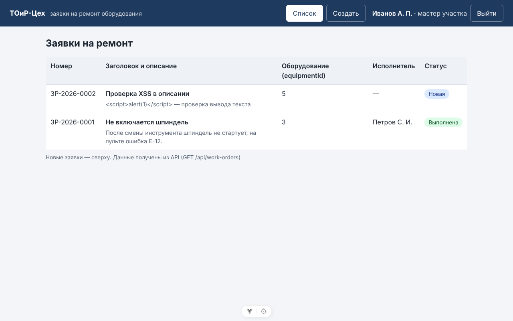
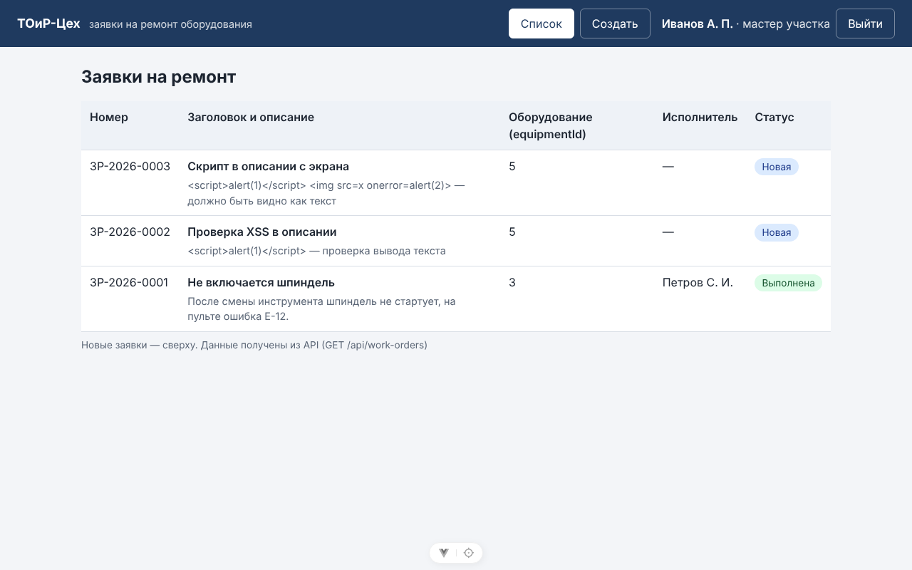
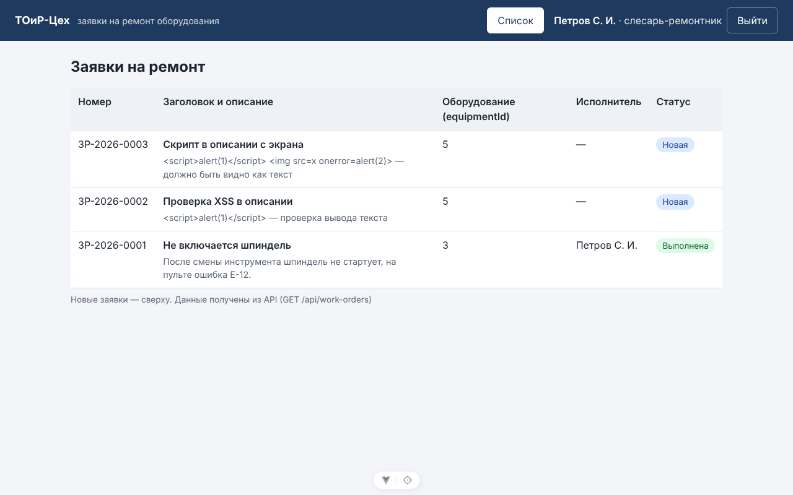

# Отчёт по лабораторной работе № 11

| Поле | Значение |
|------|----------|
| Дисциплина | Б1.В.ДЭ.01.02.02 · РИС и Web |
| Студент | Гаранин Антон |
| Группа | ТРИС-1-23 |
| Дата | 07.11.2026 |
| № ЛР | 11 |
| Тема работы | Вход и права |
| Тема проекта | «ТОиР-Цех» — веб-платформа управления техническим обслуживанием оборудования |

---

## 1. Цель

Гость не создаёт заявки (401). Вошедший без нужной роли и слесарь, который трогает чужую заявку, получают 403. Пароль в базе хранится хэшем библиотеки. Описание со `<script>` на экране Vue показывается текстом.

## 2. Способ входа

**Учебный JWT в заголовке `Authorization: Bearer <токен>`**, cookie не используются. Так обещано в контракте ЛР2 (`POST /api/auth/login` → `token`), и токен одинаково удобно передавать из Vue, Swagger и Postman. CSRF при таком способе не возникает: браузер сам не приложит заголовок `Authorization` к запросу с чужого сайта.

Внутри токена (payload, расшифрован из реального ответа входа `petrov`):

```json
{"alg":"HS256","typ":"JWT"}
{"aud":"toir-workshop-client","iss":"toir-workshop-api","exp":1794066354,"sub":"5","name":"Петров С. И.","role":"Fitter","iat":1794037554,"nbf":1794037554}
```

Payload JWT читается без ключа, поэтому в нём только id, ФИО и роль. Пароля и хэша там нет. Подделать токен нельзя: подпись HMAC-SHA256 проверяется ключом, который знает только сервер.

## 3. Что сделали

### Сервер

1. **Пакет** `Microsoft.AspNetCore.Authentication.JwtBearer` 10.0.14. `PasswordHasher` входит в ASP.NET Core, отдельного пакета не нужно.
2. **`backend/Auth/`**:
   - `JwtOptions` — Issuer, Audience и срок (8 ч) в `appsettings.json`, ключ подписи `Jwt:Key` — в user-secrets;
   - `JwtTokenService` — выпускает токен с `sub`, `name`, `role`;
   - `AuthClaims.GetUserId()` — id текущего пользователя из проверенного токена.
3. **`Controllers/AuthController.cs`**:
   - `POST /api/auth/login` → 200 и токен; 400 — пустые поля; 401 — «Неверный логин или пароль», одинаково для несуществующего логина и неверного пароля;
   - `GET /api/auth/me` — кто вошёл;
   - для несуществующего логина пароль тоже проверяется (по случайному хэшу), чтобы по времени ответа нельзя было угадать, есть ли такой логин;
   - в лог пишется только логин, пароль — никогда.
4. **Пароли.** `PasswordHasher<AppUser>` из ASP.NET Identity: PBKDF2-HMAC-SHA512, 100 000 итераций, случайная соль 16 байт у каждой строки. Хэши шести учебных пользователей записаны в seed (`Data/ReferenceData.cs`) строками. Считать их при старте нельзя: соль случайная, модель EF менялась бы при каждом запуске.
5. **Миграция `AddPasswordHashes`** (сделана `dotnet ef migrations add`):
   - записывает хэши в `users.password_hash`;
   - делает столбец `NOT NULL`, как обещано в ЛР9.

   На чистой базе обе миграции проходят подряд, на базе из ЛР10 применяется только вторая, а заявки остаются.
6. **`Program.cs`**:
   - `AddAuthentication().AddJwtBearer(...)` проверяет подпись, издателя, получателя, срок и алгоритм;
   - события `OnChallenge` (401) и `OnForbidden` (403) отвечают `ProblemDetails` на русском;
   - `UseAuthentication()` стоит перед `UseAuthorization()`.

   Без `Jwt:Key` (короче 32 байт) API не запускается и пишет команду `user-secrets`.
7. **`WorkOrdersController`**:
   - `[Authorize]` на классе: без токена любой метод отвечает 401, включая GET;
   - `[Authorize(Roles = "Foreman,Mechanic")]` на `POST`, `[Authorize(Roles = "Mechanic")]` на назначении;
   - заголовок `X-User-Id` из ЛР8 **убран**: кто действует, сервер берёт только из токена.
8. **`EfWorkOrderService`** — новый исход `ServiceError.Forbidden` → 403:
   - отказ по правам теперь 403, а не 409, как было в ЛР8;
   - 409 остался только для жизненного цикла (недопустимый переход, назначение не в `New`, «в ремонт» без исполнителя);
   - проверка чужой заявки — в `CheckTransition`: `w.AssigneeUserId != user.Id` → 403;
   - роли повторно проверяются и в сервисе (вторая линия после атрибутов).
9. **CORS** — разрешён только `http://localhost:5173` (`Cors:Origins`), заголовки `Authorization`, `Content-Type` и методы GET, POST, PATCH. Без этого браузер не отдал бы экрану `/login` ответ API с другого порта.
10. **Swagger** — схема Bearer: кнопка **Authorize** принимает токен из ответа входа.

### Клиент Vue

1. `src/api/http.js` — общий `request()`:
   - добавляет `Authorization: Bearer …`;
   - различает 401 и 403;
   - при 401 на запрос с токеном очищает сессию и открывает `/login`.

   `USE_MOCK = false`: с ЛР11 вход проверяет настоящий сервер.
2. `src/api/session.js` — токен и пользователь в `sessionStorage`: переживают F5 и пропадают при закрытии вкладки. Истёкший токен не восстанавливается.
3. `src/api/auth.js` — `login()`, `logout()`.
4. `pages/LoginPage.vue` — настоящий вход. При отказе показывается текст сервера («Неверный логин или пароль»), поле пароля очищается. После входа — возврат на страницу, куда шёл человек.
5. `router.js` — без входа `/` и `/new` открывают `/login`; `/new` только мастеру и механику.
6. `AppHeader.vue` — ФИО и роль вошедшего (ФТ-1), «Выйти»; «Создать» видна только мастеру и механику.
7. `WorkOrderTable.vue` — под заголовком показано **описание**, выводится через `{{ item.description }}`. `v-html` в проекте нет.

Структура клиента осталась прежней (`pages/`, `api/`), а не `views/` и `services/` из примера методички: так сделано с ЛР3, роль папок та же.

### Документы

- [`docs/role-matrix.md`](../role-matrix.md) — учётки, матрица «роль × действие», где проверка в коде, доказательства.
- `README.md` — способ входа, учебные логины и пароль, `Jwt:Key`, Swagger Authorize, CORS.
- `docs/api-contract.md` — уточнён ответ входа.
- Postman-коллекция и `backend.http` — вход и токены вместо `X-User-Id`, добавлены проверки 401 и 403.

## 4. Проверка сервера: один сценарий

Чистая база (`dropdb`/`createdb` → `dotnet ef database update`), API на `http://localhost:5000`, запросы `curl`. Учебный пароль у всех — `Toir-2026!`.

| № | Кто | Запрос | Ожидание | Факт |
|---|-----|--------|----------|------|
| 1 | гость | `POST /api/work-orders` | 401 | **401** «Требуется вход: передайте токен…» |
| 2 | гость | `GET /api/work-orders` | 401 | **401** |
| 3 | испорченный токен | `GET /api/work-orders` | 401 | **401** «Токен недействителен или истёк» |
| 4 | `ivanov` / `qwerty` | вход | 401 | **401** «Неверный логин или пароль» |
| 5 | `nobody` | вход | 401, тот же текст | **401** «Неверный логин или пароль» |
| 6 | `ivanov` (мастер) | вход | 200 + токен | **200** |
| 7 | мастер | `GET /api/auth/me` | 200 | **200** |
| 8 | мастер | `POST /api/work-orders` | 201 | **201**, `ЗР-2026-0001` |
| 9 | `petrov` (слесарь) | `POST /api/work-orders` | 403 | **403** «Нет прав на это действие для вашей роли» |
| 10 | `orlov` (нач. цеха) | `POST /api/work-orders` | 403 | **403** |
| 11 | мастер | назначить исполнителя | 403 (ФТ-9) | **403** |
| 12 | слесарь | назначить исполнителя | 403 | **403** |
| 13 | `kuznetsov` (механик) | назначить `petrov` на заявку 1 | 200 | **200** |
| 14 | `sidorov` (чужой слесарь) | заявка 1 → `InProgress` | 403 (ФТ-8) | **403** «Нет прав на изменение этой заявки: она назначена другому слесарю» |
| 15 | механик | заявка 1 → `InProgress` | 403 | **403** |
| 16 | `petrov` (свой слесарь) | заявка 1 → `InProgress` | 200 | **200** |
| 17 | `sidorov` | заявка 1 → `Closed` | 403 | **403** |
| 18 | `petrov` | заявка 1 → `Closed` | 200 | **200** |
| 19 | `petrov` | заявка 1 `Closed` → `InProgress` | 409 (жизненный цикл, не права) | **409** «Недопустимый переход статуса: Closed → InProgress» |
| 20 | мастер | `POST` с `<script>alert(1)</script>` в описании | 201, текст как есть | **201** |
| 21 | `smirnov` (чужой мастер) | отменить заявку `ivanov` | 403 (ФТ-7) | **403** |
| 22 | начальник цеха | `GET /api/work-orders` | 200 | **200** |
| 23 | сайт `http://localhost:5173` | CORS preflight | разрешено | `Access-Control-Allow-Origin: http://localhost:5173` |
| 24 | сайт `http://evil.example` | CORS preflight | не разрешено | заголовков `Access-Control-Allow-*` нет |

Тело ответа 14 (чужая заявка):

```json
{"type":"https://tools.ietf.org/html/rfc9110#section-15.5.4","title":"Нет прав на изменение этой заявки: она назначена другому слесарю","status":403,"traceId":"00-6b7d1b06…"}
```

Лог `dotnet run` (пароль не пишется):

```text
      Login failed; login=ivanov
      Login failed; login=nobody
      Login ok; userId=1; role=Foreman
      Login ok; userId=2; role=Mechanic
      Login ok; userId=5; role=Fitter
```

Postman-коллекция (`newman run`): 24 запроса, 38 проверок, 0 ошибок.

## 5. Пароль в таблице — хэш

```text
toir_workshop=# SELECT id, login, role, left(password_hash, 24) || '…' AS password_hash, length(password_hash) AS len FROM users ORDER BY id;
 id |   login   |   role    |       password_hash       | len
----+-----------+-----------+---------------------------+-----
  1 | ivanov    | Foreman   | AQAAAAIAAYagAAAAEK9xYXLL… |  84
  2 | kuznetsov | Mechanic  | AQAAAAIAAYagAAAAEDrCEArf… |  84
  3 | orlov     | ShopChief | AQAAAAIAAYagAAAAEOU97bNa… |  84
  4 | smirnov   | Foreman   | AQAAAAIAAYagAAAAEB7xdBVy… |  84
  5 | petrov    | Fitter    | AQAAAAIAAYagAAAAELwMJP5H… |  84
  6 | sidorov   | Fitter    | AQAAAAIAAYagAAAAEMIQbS5u… |  84
```

У всех шести один и тот же учебный пароль, а хэши разные: у каждой строки своя случайная соль. Текста `Toir-2026!` в таблице нет.

Строка хэша записана в Base64, но это **не** «пароль в Base64». Если её раскодировать, получатся байты формата Identity v3, а не пароль:

```text
01 | 00 00 00 02 | 00 01 86 a0 | 00 00 00 10 | соль 16 байт | хэш 32 байта
v3 | HMAC-SHA512 | 100 000 итераций | длина соли
```

Восстановить пароль из этих байтов нельзя, только перебирать варианты, и каждый вариант стоит 100 000 итераций PBKDF2.

## 6. Экран входа и XSS (Chrome)

Проверено в настоящем Chrome (`npm run dev`, порт 5173) скриптом на puppeteer:

| Шаг | Результат |
|---|---|
| Открыть `/` без входа | переход на `/login?redirect=/` |
| Вход `ivanov` / `qwerty` | сообщение «Неверный логин или пароль» |
| Вход `ivanov` / `Toir-2026!` | список; в шапке «Иванов А. П. · мастер участка», «Создать», «Выйти» |
| Создать на экране заявку с описанием `<script>alert(1)</script> ` | 201, в списке описание видно **текстом** |
| HTML ячейки описания | `&lt;script&gt;alert(1)&lt;/script&gt; &lt;img src=x onerror=alert(2)&gt; …` |
| Элементов `<script>`/`` в таблице | 0 |
| Окон `alert` | **0** |
| Выйти, вход `petrov` | «Петров С. И. · слесарь-ремонтник», кнопки «Создать» нет |
| `petrov` открывает `/new` по адресу | возврат на список |

Network (запросы к API :5000):

```text
POST /api/auth/login → 401  (без Authorization)
POST /api/auth/login → 200  (без Authorization)
GET /api/work-orders → 200  (Authorization: Bearer eyJhbGciOiJI…)
POST /api/work-orders → 201  (Authorization: Bearer eyJhbGciOiJI…)
GET /api/work-orders → 200  (Authorization: Bearer eyJhbGciOiJI…)
POST /api/auth/login → 200  (без Authorization)
GET /api/work-orders → 200  (Authorization: Bearer eyJhbGciOiJI…)
```

Неверный пароль:



Вход мастера — имя и роль в шапке:



Описание со скриптом — видно как текст, `alert` не всплыл:



Слесарь — кнопки «Создать» нет (запрещает всё равно сервер, см. §4, строка 9):



## 7. Секреты

```text
$ git grep -i secret      → только подсказки «dotnet user-secrets set …» в README, Program.cs и отчётах, UserSecretsId в .csproj
$ git grep -i password    → имена полей (PasswordHash, password_hash), хэши в seed и миграциях,
                             учебный пароль стенда в backend.http / README / role-matrix
```

Ключа подписи JWT и пароля PostgreSQL в Git нет. Проверено поиском их настоящих значений: совпадений 0. Оба лежат в `dotnet user-secrets`. Учебный пароль `Toir-2026!` указан в README, это разрешено методичкой: он работает только на учебном стенде.

## 8. SQL injection

SQL по-прежнему строит EF Core с параметрами: `WHERE u.login = @login`, `WHERE w.id = @id`. Логин из формы входа не склеивается со строкой SQL, поэтому `' OR 1=1 --` — это просто логин, которого нет (401).

## 9. Ответы для защиты

1. **Почему Base64 — не защита?** Base64 — это способ записать байты буквами, а не шифр: `VG9pci0yMDI2IQ==` раскодируется обратно в `Toir-2026!` без всякого ключа. Хэш PBKDF2 — односторонний: из него пароль не получить, только перебирать, и каждая попытка дорогая (100 000 итераций). Соль делает хэши одинаковых паролей разными. Base64 в нашей строке хэша — только упаковка байтов хэша и соли, пароля там нет (§5).
2. **Чем 401 отличается от 403?** 401 — сервер не знает, кто ты: нет токена, он испорчен или истёк. Надо войти. 403 — сервер знает, кто ты, но тебе это нельзя: слесарь создаёт заявку, мастер назначает исполнителя, слесарь двигает чужую заявку. Повторный вход не поможет. 409 — отдельная история: «можно тебе, но не в этом состоянии заявки».
3. **Где в коде проверяют чужой id?**
   - `backend/Services/EfWorkOrderService.cs`, метод `CheckTransition`: `if (w.AssigneeUserId != user.Id) return Forbidden(...)` для «в ремонт» и «выполнена»; `w.CreatedByUserId == user.Id` для отмены мастером;
   - `user` берётся из `User.GetUserId()` — утверждения `sub` проверенного токена. Подставить в адрес чужую заявку можно, а себя за другого выдать нельзя;
   - спрятанная кнопка во Vue — только удобство, запрос из Swagger получает тот же 403.

## 10. Что осталось на следующую работу

1. ЛР12: назначение и смена статуса на экране (через API уже работают с правами), сквозной сценарий двумя входами, README «с нуля».
2. `GET /api/equipment` и `GET /api/users?role=Fitter` из контракта ЛР2 — для выпадающих списков формы и назначения.
3. Токен хранится в `sessionStorage`: скрипт страницы может его прочитать. Это учебный компромисс; поэтому весь пользовательский текст выводится через `{{ }}`.

---

Подпись студента: __________ дата: __________
