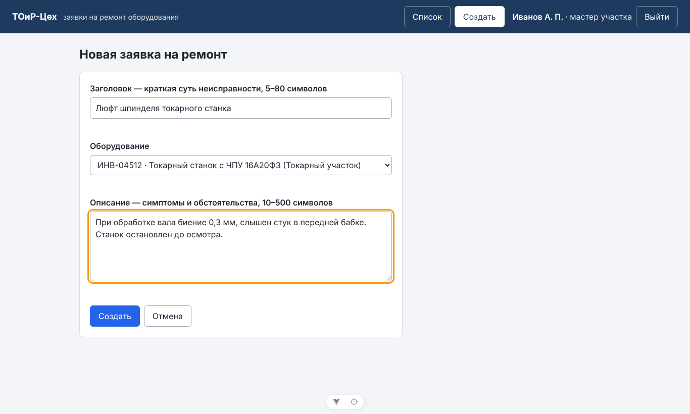
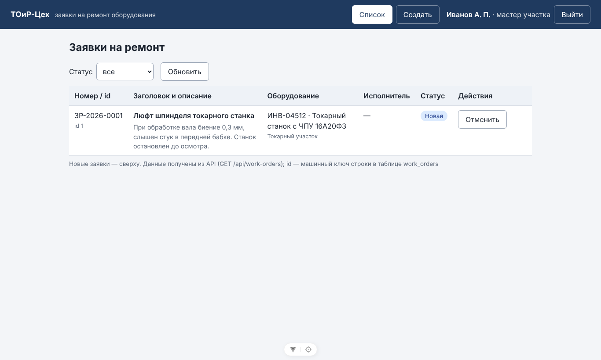
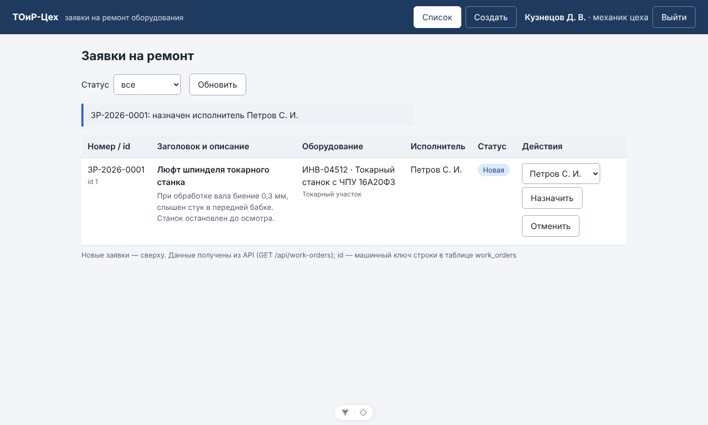
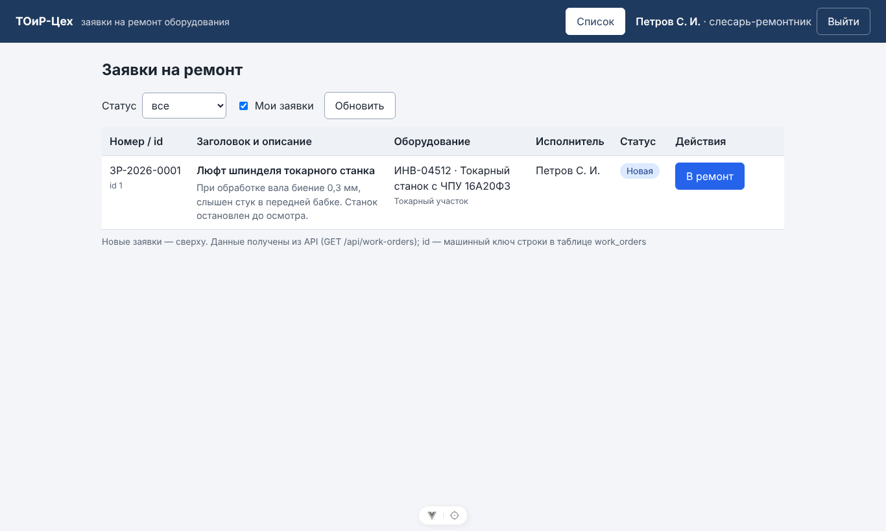
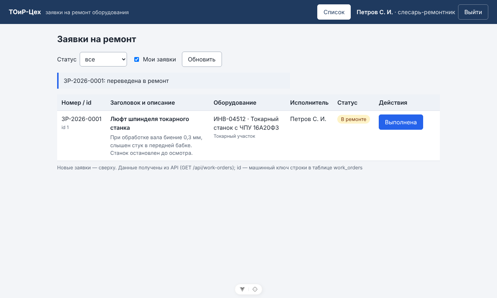
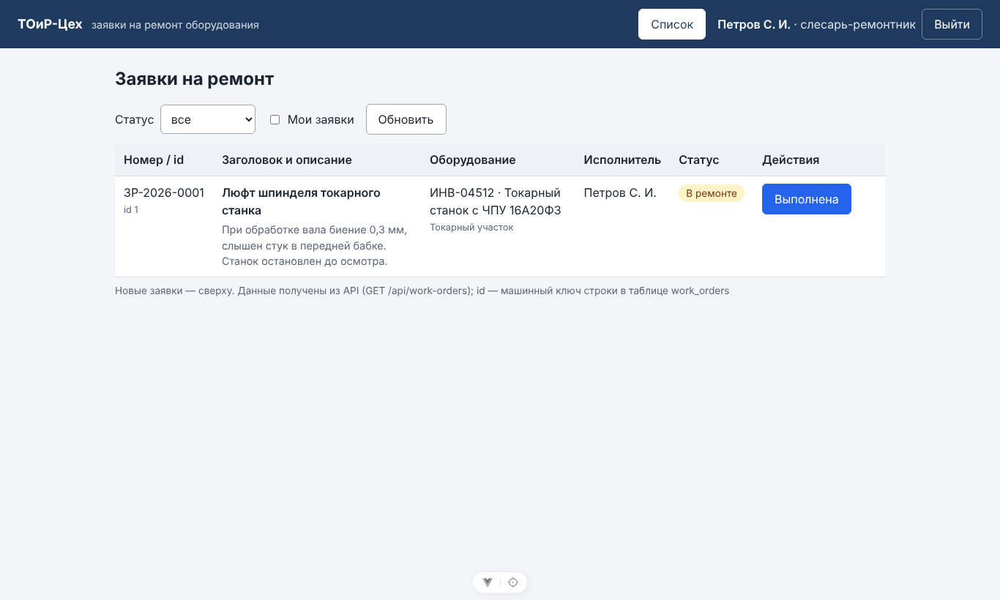

# Отчёт по лабораторной работе № 12

| Поле | Значение |
|------|----------|
| Дисциплина | Б1.В.ДЭ.01.02.02 · РИС и Web |
| Студент | Гаранин Антон |
| Группа | ТРИС-1-23 |
| Дата | 07.11.2026 |
| № ЛР | 12 |
| Тема работы | Сквозная сборка |
| Тема проекта | «ТОиР-Цех» — веб-платформа управления техническим обслуживанием оборудования |

---

## 1. Цель

Развёрнутый стенд: Vue :5173 + API :5000 + PostgreSQL. Одна заявка видна с одним и тем же `id` на экране, в Network и в таблице базы и переживает рестарт API. Три критерия ЛР1 проходятся на экране, без ручных правок в базе. README позволяет развернуть стенд с нуля.

## 2. Что сделали

### Сервер

1. **`GET /api/equipment`** (все вошедшие) — оборудование с инвентарным номером и названием участка (JOIN `equipment` × `areas`), для выпадающего списка формы и подписей в списке.
2. **`GET /api/users?role=Fitter`** (только механик, остальным 403) — слесари для «Назначить». В ответе нет ни логина, ни хэша пароля. Неизвестная роль в параметре → 400.

   Оба метода были в контракте ЛР2, но до этой работы не были сделаны.
3. CORS для `http://localhost:5173` настроен ещё в ЛР11 (там без него не работал экран входа). Проверено: чужой origin заголовков `Access-Control-Allow-*` не получает.

### Клиент

1. **Mock выключен через `.env`**: `VITE_USE_MOCK=false`, `VITE_API_BASE_URL=http://localhost:5000` (`frontend/.env.example`). Раньше флаг был константой в коде.
2. **Список** (`WorkOrderList.vue`, `WorkOrderTable.vue`):
   - у каждой строки номер **и `id`**;
   - вместо `equipmentId` — инвентарный номер, название станка и участок;
   - кнопки действий по ролям:

     | Кто | Кнопки |
     |-----|--------|
     | механик цеха | выбор слесаря + «Назначить», «Отменить» |
     | назначенный слесарь | «В ремонт» / «Выполнена» |
     | мастер-автор | «Отменить» у своей новой заявки |

   - после действия строка заменяется ответом сервера;
   - отказ (403 «Нет прав…», 409) показывается текстом сервера у строки;
   - фильтр по статусу (ФТ-11) и «Мои заявки» для слесаря (ФТ-12).
3. **Форма** (`WorkOrderNew.vue`) — оборудование выбирается из `GET /api/equipment`. Если справочник не загрузился, остаётся старое поле для номера.

### Документы

- **`README.md` переписан** как инструкция поставки: стенд и порты, версии, развёртывание с нуля по шагам (Windows/PowerShell), учебные логины, проверочный сценарий на 3 минуты, обход экрана через Swagger, API, устройство, ограничения.
- **`docs/acceptance-check.md`** — три критерия ЛР1: шаг, что ждём, где смотреть (экран / запрос / SQL).
- **`docs/known-defects.md`** — 11 дефектов с приоритетом, воспроизведением и обходом.
- Postman-коллекция и `backend.http` — добавлены справочные методы. `newman`: 27 запросов, 43 проверки, 0 ошибок.

## 3. Сквозной сценарий: один id

Чистая база (`createdb` → `dotnet ef database update`), API и Vite запущены, Chrome. Все действия — **на экране**, не в Swagger.

> **id = 1 · number = ЗР-2026-0001**

### 3.1. Мастер `ivanov` создаёт заявку (критерий 1)



Network:

```text
POST /api/auth/login → 200
GET /api/equipment → 200
POST /api/work-orders → 201
    request:  {"title":"Люфт шпинделя токарного станка","equipmentId":3,"description":"При обработке вала биение 0,3 мм, слышен стук в передней бабке. Станок остановлен до осмотра."}
    response: {"id":1,"number":"ЗР-2026-0001","title":"Люфт шпинделя токарного станка", … ,"status":"New","equipmentId":3, …}
GET /api/work-orders → 200
```

На экране: `ЗР-2026-0001 · id 1 · ИНВ-04512 · Токарный станок с ЧПУ 16А20Ф3 · — · Новая`.



### 3.2. Механик `kuznetsov` назначает Петрова (критерий 2)

```text
GET /api/users?role=Fitter → 200
PATCH /api/work-orders/1/assignee → 200
    request:  {"assigneeUserId":5}
    response: {"id":1,"number":"ЗР-2026-0001", … ,"status":"New", …}
```

На экране: исполнитель «Петров С. И.», статус **остался «Новая»**, сообщение «ЗР-2026-0001: назначен исполнитель Петров С. И.».



### 3.3. Чужой слесарь `sidorov` (критерий 3, запрет)

- На экране у заявки 1 **нет кнопок** (в строке 0 кнопок).
- В обход экрана — запрос с токеном `sidorov` (как из Swagger):

```text
PATCH /api/work-orders/1/status  {"status":"Closed"}
{"type":"https://tools.ietf.org/html/rfc9110#section-15.5.4","title":"Нет прав на изменение этой заявки: она назначена другому слесарю","status":403, …}
→ HTTP 403
```

### 3.4. Слесарь `petrov` переводит в ремонт (критерий 3)



```text
PATCH /api/work-orders/1/status → 200
    request:  {"status":"InProgress"}
    response: {"id":1,"number":"ЗР-2026-0001", … ,"status":"InProgress", …}
```



### 3.5. Та же строка в базе

```text
toir_workshop=# SELECT w.id, w.number, w.title, w.status, w.assignee_user_id, u.full_name AS assignee
                FROM work_orders AS w LEFT JOIN users AS u ON u.id = w.assignee_user_id WHERE w.id = 1;
 id |    number    |             title              |   status   | assignee_user_id |   assignee
----+--------------+--------------------------------+------------+------------------+--------------
  1 | ЗР-2026-0001 | Люфт шпинделя токарного станка | InProgress |                5 | Петров С. И.
(1 row)
```

### 3.6. Рестарт API

```text
  PID  STARTED
  807  Sat Nov  7 08:02:57 2026           ← API до остановки
info: Microsoft.Hosting.Lifetime[0]
      Application is shutting down...
--- API не отвечает
 1119  Sat Nov  7 08:03:55 2026           ← новый процесс
      Now listening on: http://localhost:5000
```

Вход `petrov`, обновление списка: `ЗР-2026-0001 · id 1 · Петров С. И. · В ремонте · [Выполнена]`.



### 3.7. Сводка: один id везде

| Где | Что видно | id |
|-----|-----------|----|
| Экран (мастер, механик, слесарь) | строка `ЗР-2026-0001`, `id 1` | 1 |
| Network | `POST /api/work-orders` → 201, `"id":1`; `PATCH /api/work-orders/1/assignee` → 200; `PATCH /api/work-orders/1/status` → 200 | 1 |
| SQL | `WHERE id = 1` → `InProgress`, `assignee_user_id = 5` | 1 |
| После рестарта API | та же строка, «В ремонте» | 1 |

Окон `alert` за сценарий: 0.

## 4. Три критерия ЛР1

Подробная таблица «шаг — что ждём — где смотреть» — [`docs/acceptance-check.md`](../acceptance-check.md).

| Критерий | Да / нет | Доказательство |
|----------|----------|----------------|
| 1. Мастер создаёт заявку → «Новая», номер `ЗР-2026-0001` | **да** | §3.1: экран, `POST` 201, SQL |
| 2. Механик назначает слесаря отдельным действием, статус остаётся «Новая» | **да** | §3.2: экран, `PATCH …/assignee` 200, `"status":"New"` |
| 3. Назначенный слесарь переводит в «В ремонте»; другой слесарь не может (403) | **да** | §3.3–3.5: 403 для `sidorov`, 200 для `petrov`, SQL `InProgress` |

## 5. Молчаливый тест «соседа»

Ноутбук соседу передать нельзя, поэтому сымитировал чистое рабочее место:

- файлы проекта (только то, что идёт в Git) — в новую папку;
- **пустой домашний каталог**: нет моих user-secrets, кэша NuGet и `dotnet-ef`;
- новая база;
- выполнялись **только команды из README**, по порядку, без подсказок.

| Шаг README | Результат |
|------------|-----------|
| 0.4 `dotnet tool install --global dotnet-ef` | `dotnet-ef` 10.0.14 установлен |
| 2 `createdb … toir_workshop` | база создана |
| 3 `dotnet user-secrets set …` (строка подключения и `Jwt:Key`) | сохранено в профиле пользователя, не в папке проекта |
| 4 `dotnet ef database update` | **упало**: `NETSDK1004: Assets file '…/obj/project.assets.json' not found` |

**Дефект README найден и исправлен.** На свежей копии пакеты NuGet ещё не восстановлены, а `dotnet ef` сам их не скачивает. У меня это не проявлялось, потому что проект раньше уже собирался. В шаг 4 добавлен `dotnet restore` с пояснением. Повтор по исправленному README:

| Шаг README | Результат |
|------------|-----------|
| 4 `dotnet restore` + `dotnet ef database update` | `Applying migration '…_InitialCreate'`, `'…_AddPasswordHashes'`, `Done.` |
| 5 `dotnet run` | `Now listening on: http://localhost:5000`, `/health` → `ok`, `/swagger` → 200 |
| 6 `copy .env.example .env`, `npm install`, `npm run dev` | `Local: http://localhost:5173/`, экран входа открывается |
| Проверочный сценарий README (ivanov → kuznetsov → sidorov → petrov) | `id = 1`, `ЗР-2026-0001`; назначен Петров; у Сидорова кнопок нет; «В ремонте» |
| SQL из README | `1 | ЗР-2026-0001 | … | InProgress | 5` |
| Рестарт API, обновить страницу | заявка на месте, «В ремонте» |

Стенд развёрнут по тексту README без устных подсказок.

## 6. Что в Git и чего там нет

`.gitignore` закрывает `bin/`, `obj/`, `node_modules/`, `dist/`, `.env` (кроме `.env.example`), дампы (`*.dump`, `*.backup`) и `.pgpass`. Проверено `git status --ignored`: `backend/bin`, `backend/obj`, `frontend/.env`, `frontend/dist`, `frontend/node_modules` — в списке игнорируемых. Строка подключения и `Jwt:Key` — в user-secrets. Поиск их настоящих значений по репозиторию — 0 совпадений.

## 7. Как я искал проблемы

Порядок из методички: сначала Network, потом консоль, потом лог `dotnet`, потом таблица.

- Тест соседа упал на `dotnet ef` — ошибка в выводе команды прямо указала на отсутствующий `project.assets.json`, то есть на пропущенный `restore`. Код при этом не трогал, исправлена инструкция.
- В сценарии все запросы на порт 5000 видны в Network с кодами 200/201. CORS-ошибок нет: у preflight с `http://localhost:5173` есть `Access-Control-Allow-Origin`.

## 8. Ответы для защиты

1. **Как доказать, что это одна и та же заявка?** По `id`:
   - он виден в строке списка;
   - он же в теле ответа `POST` 201 и в адресах `PATCH /api/work-orders/1/…` в Network;
   - по нему ищу строку `SELECT … WHERE id = 1`.

   Номер `ЗР-2026-0001` — для людей, `id` — машинный ключ, и они совпадают во всех трёх местах.
2. **Почему CORS, а не 500?** Клиент (:5173) и API (:5000) — разные origin. Браузер отдаёт ответ скрипту, только если сервер разрешил этот origin. При CORS-ошибке в Network нет нормального кода ответа, а Swagger на том же API работает. При 500 код ответа есть.
3. **Что, если спрятанную кнопку обойти?** Сервер отвечает 403 (§3.3): права проверяются в API, кнопки — только удобство.

## 9. Что осталось (в ЛР13)

Приоритетные дефекты из [`docs/known-defects.md`](../known-defects.md):

- №2 — одновременная правка одной заявки, токен конкурентности;
- №4 — выдача номера без 409 при параллельном создании;
- №5 — фильтры на сервере и постраничная загрузка.

---

Подпись студента: __________ дата: __________
