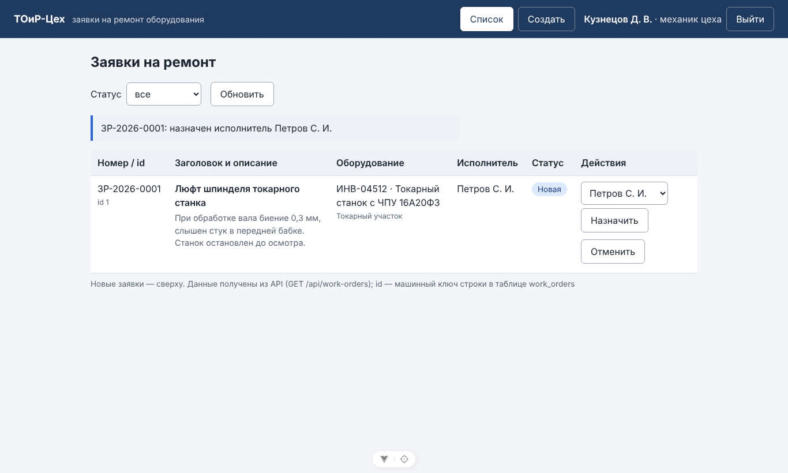
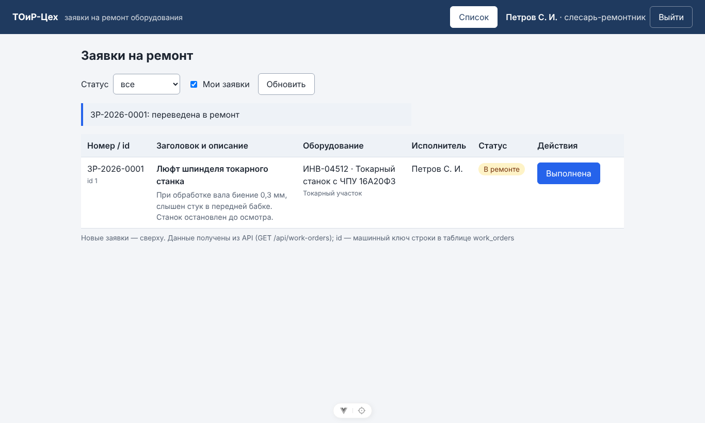
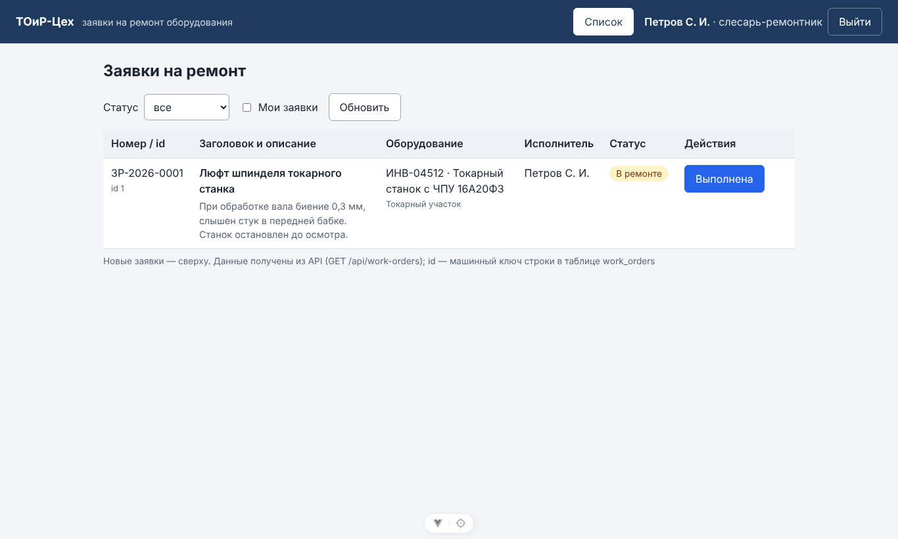
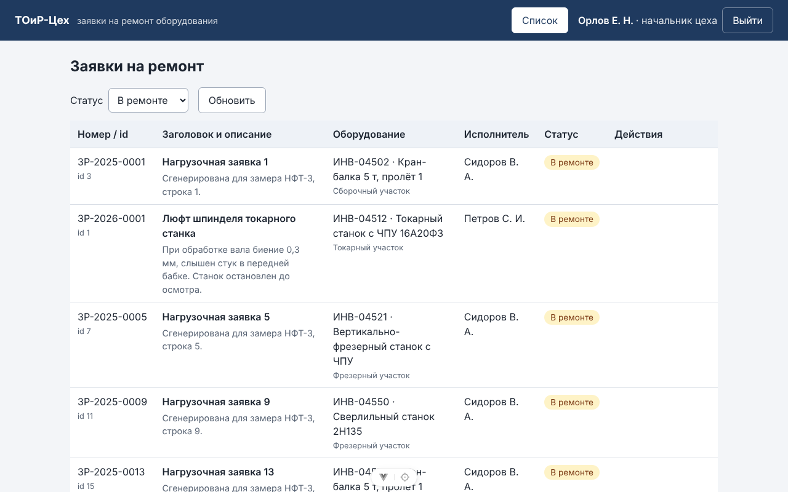

# Отчёт по лабораторной работе № 13

| Поле | Значение |
|------|----------|
| Дисциплина | Б1.В.ДЭ.01.02.02 · РИС и Web |
| Студент | Гаранин Антон |
| Группа | ТРИС-1-23 |
| Дата | 12.11.2026 |
| № ЛР | 13 |
| Тема работы | Предзащита |
| Тема проекта | «ТОиР-Цех» — веб-платформа управления техническим обслуживанием оборудования |

---

## 1. Цель

Стенд разворачивается другим человеком по README. Дефекты запуска и трёх критериев найдены, исправлены и перепроверены повторным прогоном. Демо укладывается в 7 минут. Пояснительная записка ссылается на фактические файлы репозитория. Новых больших функций нет.

**Цель семестра** — трёхзвенная веб-ИС «ТОиР-Цех» (Vue 3 → ASP.NET Core → PostgreSQL) для службы главного механика механосборочного цеха № 2 завода «Уралмаш». Система ведёт заявку на ремонт оборудования: мастер создаёт → механик назначает слесаря → слесарь берёт в ремонт и закрывает. Права проверяются на сервере, данные хранятся в базе.

## 2. Что сделали

1. **Тест соседа.** `git clone` коммита ЛР12 (`8955ae2`) в пустую папку, чистый профиль пользователя (нет user-secrets, кэша NuGet и `dotnet-ef`), новая база, только команды README. Стенд поднялся.
2. **Найдены и оформлены дефекты** D-01…D-04 в формате «шаги — ожидали — получили — причина — исправление — повторная проверка — статус» — [`docs/predefense-check.md`](../predefense-check.md) §2.
3. **Исправлен D-02.** `dotnet tool install --global dotnet-ef` теперь ставит EF 11, а проект на EF Core 10. В README шаг 0.4 закреплён на `--version "10.0.*"`. Перепроверено на новом пустом профиле → 10.0.15, миграции и модель в порядке.
4. **Перепроверен D-01 из ЛР12** (`dotnet restore`) — не вернулся.
5. **Закрыт D-03.** Впервые замерен НФТ-3: 502 заявки — API 15–32 мс, таблица в Chrome 0,28–0,47 с при норме 2 с.
6. **Поиск 500.** 25 запросов с ошибками и граничными значениями — ни одного 500, все 400/401/404/415. Найдена косметика D-04 (стандартные 415/404 не по-русски) — оставлена открытой, в `known-defects.md` №12.
7. **Повтор трёх критериев** на чистом стенде соседа, новый `id = 1`, всё на экране Chrome. Плюс 401 без входа, 403 чужому слесарю, рестарт API — [`docs/predefense-check.md`](../predefense-check.md) §4, [`docs/acceptance-check.md`](../acceptance-check.md).
8. **План демо на 7 минут** по минутам с текстом и **ответы на шесть вопросов** со ссылками на файлы — [`docs/predefense-check.md`](../predefense-check.md) §5–6.
9. **Пояснительная записка** — [`docs/kursovaya-zapiska.md`](../kursovaya-zapiska.md) по шаблону ЛР13: семь глав, таблица выполнения ФТ/НФТ, запас ВКР, приложения «Трассировка» и «Словарь».
10. **Обновлены** `README.md` (шаг `dotnet-ef`, версии, ЛР13 в таблице), `docs/known-defects.md` (замер НФТ-3, №12, закрытые на предзащите), `docs/acceptance-check.md` (второй прогон).

Код приложения в ЛР13 не менялся. Мелкая доработка не делалась: она допускается только с согласия преподавателя.

## 3. Доказательство успеха

| Что проверяли | Как | Результат |
|---------------|-----|-----------|
| Развёртывание по README | клон + чистый профиль + новая БД, команды README по порядку | ок: `Done.` после миграций, `Now listening on: http://localhost:5000`, `Local: http://localhost:5173/` |
| Критерий 1: создать | UI `ivanov` → `POST /api/work-orders` → SQL | ок: `201`, `"id":1`, `ЗР-2026-0001`, `New` |
| Критерий 2: назначить | UI `kuznetsov` → `PATCH /api/work-orders/1/assignee` | ок: `200`, `assignee_user_id = 5`, статус `New` |
| Критерий 3: в работу | UI `petrov` → `PATCH /api/work-orders/1/status` | ок: `200`, `InProgress` |
| Сохранность | рестарт API (новый PID), вход `petrov` | ок: `ЗР-2026-0001 · id 1 · Петров С. И. · В ремонте` |
| НФТ-3 | 502 заявки, Chrome | ок: 0,28–0,47 с |
| Исправление D-02 | команда из README на пустом профиле | ок: `dotnet-ef 10.0.15` |

Один `id` везде:

```text
Network:  POST /api/work-orders → 201  {"id":1,"number":"ЗР-2026-0001",…,"status":"New",…}
          PATCH /api/work-orders/1/assignee → 200  {"assigneeUserId":5}
          PATCH /api/work-orders/1/status   → 200  {"status":"InProgress"}

SQL:       id |    number    |   status   | assignee_user_id |   assignee   | updated
          ----+--------------+------------+------------------+--------------+---------
            1 | ЗР-2026-0001 | InProgress |                5 | Петров С. И. | t
```

Назначение — механик:



В ремонте — назначенный слесарь:



После рестарта API:



502 заявки у начальника цеха (НФТ-3):



## 4. Доказательство ошибки / отказа

| Что сделали неверно / отказ | Ожидание | Факт |
|-----------------------------|----------|------|
| `POST /api/work-orders` без входа | 401 | **401** «Требуется вход: передайте токен в заголовке Authorization: Bearer …» |
| `sidorov` (другой слесарь) → `PATCH /api/work-orders/1/status` `{"status":"Closed"}` | 403, статус не меняется | **403** «Нет прав на изменение этой заявки: она назначена другому слесарю»; в БД `InProgress` |
| `sidorov` на экране | кнопок у чужой заявки нет | 0 кнопок в строке |
| Заголовок `"     ab"` (после обрезки 2 символа) | 400, не 500 | **400**, `errors.title` |
| `equipmentId: 2147483648` | 400, не 500 | **400**, `errors.equipmentId` |
| Логин `' OR 1=1 --` | 401, не вход и не 500 | **401** «Неверный логин или пароль» |
| `dotnet tool install --global dotnet-ef` по старому README | 10.0.x | было **11.0.0** → D-02, исправлено |

## 5. Что сделано за семестр — где лежит

| Папка | Что внутри | Работы |
|-------|------------|--------|
| [`/docs`](..) | заявка на тему, требования, архитектура, модель данных, контракт API, матрицы требований и ролей, критерии, дефекты, предзащита, записка, отчёты ЛР2–ЛР13 со скриншотами, Postman-коллекция | ЛР1–ЛР13 |
| [`/frontend`](../../frontend) | Vue 3 + Vite: `/login`, `/` (список с действиями по ролям), `/new`; клиент API `src/api/` | ЛР3–ЛР6, ЛР11–ЛР12 |
| [`/backend`](../../backend) | ASP.NET Core Web API: контроллеры, DTO, сервис с правилами и правами, EF Core `AppDbContext`, миграции, JWT | ЛР7–ЛР8, ЛР10–ЛР12 |
| [`/db`](../../db) | `schema.sql`, `seed.sql`, `queries.sql` — справочная схема и запросы | ЛР9 |
| [`README.md`](../../README.md) | развёртывание с нуля, логины, проверочный сценарий | ЛР12–ЛР13 |

**Что не вошло и почему.** Семестр — ядро процесса «заявка на ремонт». Остальное — запас ВКР из заявки на тему (`docs/project-proposal.md` §7), и всё это опирается на сделанное ядро:

- графики ППР;
- история отказов;
- 1С / склад;
- датчики SCADA;
- несколько цехов;
- отчёты MTTR/MTBF.

Из требований ЛР1 частично выполнены два:

- ФТ-11 — нет фильтра по оборудованию;
- НФТ-4 — проверен только Chrome.

Это честно записано в записке (§7) и в `known-defects.md`.

## 6. Что осталось

1. Провести репетицию демо с таймером (2 прогона) и вписать время в таблицу `docs/predefense-check.md` §5. Пусть сосед задаст три вопроса из §6.
2. Если преподаватель согласует одну мелкую доработку — кандидаты:
   - защита от одновременной правки (`known-defects.md` №2);
   - фильтр по оборудованию для ФТ-11 (№6).
3. Перенести записку в DOCX по УММ кафедры: титул, руководитель, оформление.

## 7. Запуск

Полностью — `README.md`, «Развёртывание с нуля». Кратко, PowerShell:

```powershell
dotnet tool install --global dotnet-ef --version "10.0.*"
createdb -U postgres toir_workshop
cd backend
dotnet user-secrets set "ConnectionStrings:Default" "Host=localhost;Port=5432;Database=toir_workshop;Username=postgres;Password=ВАШ_ПАРОЛЬ_POSTGRES"
dotnet user-secrets set "Jwt:Key" "ЛЮБАЯ_СЛУЧАЙНАЯ_СТРОКА_НЕ_КОРОЧЕ_32_СИМВОЛОВ"
dotnet restore
dotnet ef database update
dotnet run
# второй терминал
cd frontend
copy .env.example .env
npm install
npm run dev
```

Вход: `http://localhost:5173`, `ivanov` / `Toir-2026!`.

---

Подпись студента: __________ дата: __________
